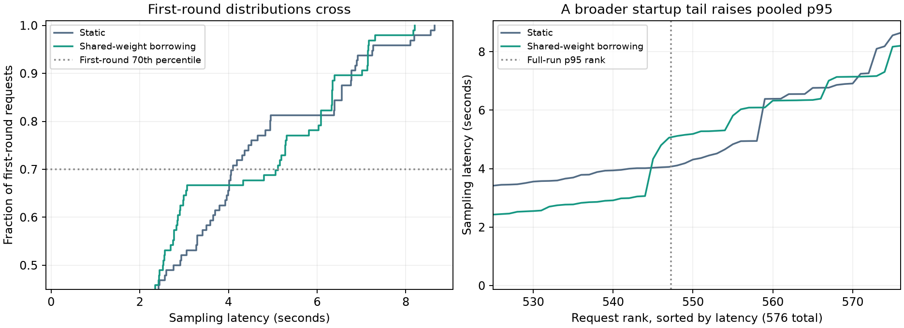
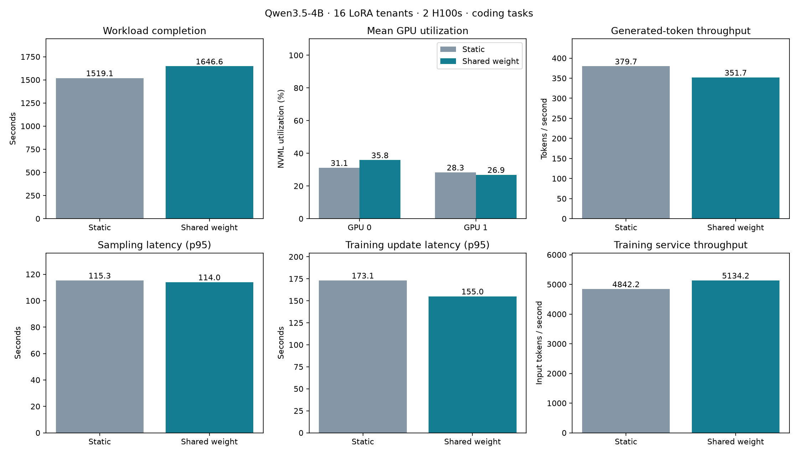
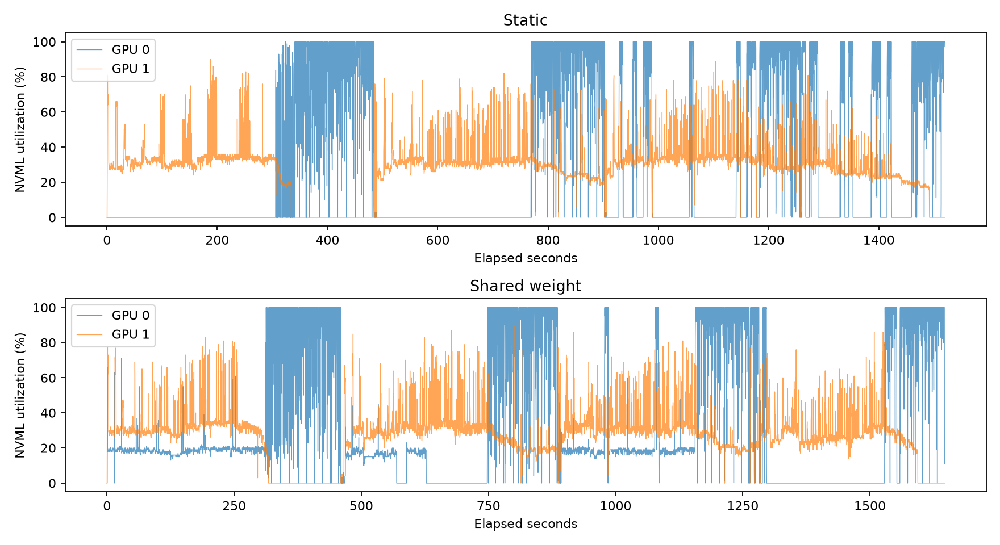

# GPU borrowing (experimental): benchmarks

The [user guide](../../docs/sphinx_doc/source/user-guide/borrowing.md) explains
how to enable this feature, the benchmark setup, results, and limitations.
It includes latency, allocated GPU time and sampled GPU utilization.

This directory contains the feature's benchmark code and example configurations:

- `benchmark_shared_weight.py`: real-engine correctness and performance workload.
- `benchmark_shared_weight_agents.py`: multi-tenant, three-turn agent workload.
- `tuft_config.shared-weight.h100.yaml`: HF example using two H100 GPUs.
- `tuft_config.shared-weight.fsdp.h100.yaml`: FSDP example using four H100 GPUs.

The example YAML files are starting points, not the eager, long-context settings
used for the saved agent comparison. Exact run settings and software versions
are recorded in each run's `model_config` and `versions` in the raw telemetry.


Current borrowing is reactive: dedicated admission slots fill first, and idle
training GPUs serve bounded overflow. There are no calibration probes or duration
predictions. Older figures and reports below describe their recorded scheduler
revisions, not the current implementation. The retired predictive-scheduler
launchers are preserved as source text in `archive/`; their saved results remain
available, but they are not runnable against this version.

The directory is named for **GPU borrowing**, the scheduling feature. Use `sampling.borrowing.enabled: true` to enable it. Borrowing controls replica
eligibility; round-robin placement is independent. Existing script names remain unchanged. Archived telemetry and provenance retain their original names.

## Independent-client workload

The [static 1/2/4/8-tenant report](static-independent-20261106-results.md) measures
how much spare trainer capacity remains as independent agent clients are added.
Each tenant runs eight four-turn coding trajectories, trains, publishes its LoRA
adapter, and repeats. Randomized arrivals and client/tool delays avoid an initial
cross-tenant barrier. Borrowing is disabled in all four arms.

- [Utilization and latency timelines](static-independent-analysis/static-timelines.png).
- [Client phases](static-independent-analysis/static-client-phases.png).
- [Windowed results](static-independent-analysis/static-latency-summary.json),
  [validation](static-independent-analysis/validation.json).

`report_static_timelines.py` regenerates these figures from saved telemetry without
GPU work. `independent_clients.py` defines reproducible client timing. The report records
the exact workload and measurement window. These results describe static capacity;
they do not establish a benefit from borrowing.

## Current reactive borrowing comparison

The [checkpoint/publication fix comparison](publication-fix-20261106-results.md)
removed the long publication stall. Borrowing still traded faster sampling for
longer training waits, with no demonstrated throughput improvement. The report
includes aligned figures, validation and the remaining admission limitation.

The [matched eight-tenant comparison](reactive-comparison-20261106-results.md)
uses the preceding implementation and the guide's independent-client workload.
Borrowing served repeated overflow, but output throughput fell and training latency
increased. The report identifies checkpoint/publication queueing and borrowed-request
drain waits, and includes aligned figures and saved metrics.

## Earlier comparisons: saved data and figures

- [Raw telemetry](agent-telemetry.json) and [summary](agent-results.json).
- [Agent results](agent-results.png) and [GPU utilization](gpu-utilization.png).
- [Startup-tail analysis](startup-tail.json) and [figure](startup-tail.png).

These measurements predate the PR extraction. Policy labels were renamed; raw
measurements are unchanged. The excluded predictive planner applied no holds;
the raw `infeasible_plans` counter comes from that component. Reactive alignment
was zero in this run and remains disabled by default. No performance change from
the extraction or later CPU fixes is claimed.

GPU utilization was calculated later from these saved readings, without a new GPU
run. It is the arithmetic mean of NVML GPU-active percentages sampled roughly
every 0.2 seconds, not SM occupancy or FLOP utilization. The two-GPU average is
36.48% static versus 40.44% shared weights (+3.97 percentage points).

## Latency diagnosis and measurement limits

The reported p95 is sampling-request latency over the entire timed workload,
including the first rollout round. Server initialization and warmup are excluded.
We examined the first round because the full-run p95 rose from 4.072 s to 5.075 s,
even though average latency and workload completion time improved. It is a check
on the cost of borrowing, not the feature's main optimization target.

All 29 requests above the shared-weight arm's pooled p95 were first-turn requests
in the initial round. Later-round p95 was 1.937 s versus 2.813 s static. Warmup
sampling bypassed the scheduler, and the dedicated sampler's initial service was
slower in the shared-weight run. The borrowing sampler made nine serial cold
probes while waiting for the dedicated sampler to drain. Training and publication
drains did not cause these outliers. No predictive holds were applied.



The saved telemetry does not explain why the dedicated sampler started more
slowly. Calibration under sustained load, correlated scheduler/engine timing, and
representative warmup remain follow-up investigations. Later-round results help
locate the slow requests; they do not replace the full-run result or establish
steady-state latency in a long-running deployment.

Training service also improved, so the wall-time gain cannot all be attributed
to scheduling. This workload verifies multi-tenant system behavior, not learning
convergence or numerical equivalence between training and inference.

## Regenerate reports without GPUs

From the repository root, using an environment with Matplotlib installed:

```bash
mkdir -p /tmp/shared-weight-report
cp benchmarks/borrowing/agent-telemetry.json /tmp/shared-weight-report/
python benchmarks/borrowing/report_shared_weight_agents.py /tmp/shared-weight-report/agent-telemetry.json
python benchmarks/borrowing/diagnose_shared_weight_agent_tail.py /tmp/shared-weight-report/agent-telemetry.json --plot
```

Outputs go to `/tmp/shared-weight-report/` and use the input stem: `agent-telemetry-summary.json`, `agent-telemetry.png`,
`agent-telemetry-gpu-utilization.png`, and `agent-telemetry-tail-diagnosis.json/png`,
plus SVG, per-round latency figures, and `agent-telemetry-sensitivity.json`. The archived files above use shorter names.
For the other workload, `summarize_shared_weight.py` summarizes the output of
`benchmark_shared_weight.py`.

GPU integration tests require explicit `--gpu`; they cover shared storage, adapter
isolation, publication, phase changes, and FSDP shard/gradient equivalence. No new
GPU experiments were run for this documentation update.

## Coding-agent comparison

`benchmark_coding_modal.py` compares static and shared-weight scheduling on two
H100s with Qwen3.5-4B and 16 LoRA tenants. Each trajectory implements four versions
of a Python report service. Generated code runs in isolated CPU sandboxes, and
test feedback drives the next turn. Each trajectory has four turns, including feedback and a new requirement on
each subsequent turn. Task success is reported but does not gate the systems comparison. The test
pass fraction supplies the training reward. This evaluates system behavior, not policy convergence.

Both dedicated samplers admit up to 32 requests, support 32 vLLM sequences and
16 active adapters, and use a 16 GiB KV cache. Shared-GPU borrowing is separately
limited to four requests and drains before training. Borrowed requests can refill as they complete while dedicated slots remain full. Eager execution remains
enabled in both arms. Outputs stop naturally, with a 1,536-token allowance.
The test runner explicitly supplies the configuration constants. Each turn keeps
the current complete code file and all requirements, without obsolete drafts.

Start with one calibration:

```bash
modal run --detach benchmarks/borrowing/benchmark_coding_modal.py --calibration
```

Calibration uses shared-weight mode, 16 tenants, three trajectories each, and
one update per tenant (48 trajectories, 192 sampling requests, and
16 updates). It exercises both GPUs, actual LoRA batching, borrowing and training memory reclamation. Inspect
vLLM running-sequence/adapter counts, cache use, preemptions, GPU memory,
throughput, output truncation and successful trajectories before the full pair.

The full comparison uses four trajectories and four updates per tenant:

```bash
modal run --detach benchmarks/borrowing/benchmark_coding_modal.py
```

New comparisons use the shared-base setup in both arms, with borrowing disabled
for the `static` arm. This keeps shared-base placement and dedicated admission
settings identical. Older archived comparisons retain their original policy
labels and configurations.

Both arms use the same tasks, sampling seeds, admission settings and allocation.
HF adapter initialization is not explicitly seeded, so these are independent
training runs rather than identical trajectory replays. Compare actual token
counts and test success alongside throughput. Initialization and warmup are
outside measurement, but still incur charges.

The offline admission allowance is 600 seconds in both arms; production retains
its 120-second default. Partial request, tool, scheduler, engine and GPU telemetry
is saved every 15 seconds and on failure, including before the first update.
There is no dollar cutoff or automatic workload retry. Results persist in the
`tuft-shared-weight-experiments` Modal Volume and are copied locally under `runs/`.
Use `--resume-run <run-id>` to reuse completed arms after an interruption; the
launcher first checks workload and implementation hashes for compatibility.

`report_coding_comparison.py <run-directory>/comparison.json` saves the summary,
comparison figures and GPU timeline without rerunning the workload.

The earlier 16-sequence/four-adapter run was stopped and preserved. Its initial
wave needed 128 seconds for admission, and 59 of 64 final-turn responses reached
the old 768-token limit. It is diagnostic data, not a completed comparison.
The HF training path also needed explicit training mode to activate the gradient
checkpointing it had already enabled; a real-model CPU regression test covers it.

### Qwen3.5 comparison result

One ordered static/shared comparison used Qwen3.5-4B, two H100s, 16 tenants,
four trajectories and four updates per tenant. Each arm completed 1,024 sampling
requests and 64 updates. Dedicated samplers used the same 32-sequence,
16-adapter and 16 GiB KV settings; shared borrowing was capped at four requests.

| Measurement | Static | Shared |
| --- | ---: | ---: |
| Completion time | 1,519 s | 1,647 s |
| Output tokens/s, whole workload | 379.7 | 351.7 |
| Trainer GPU utilization | 31.1% | 35.8% |
| Dedicated GPU utilization | 28.3% | 26.9% |
| Sampling p95 | 115.3 s | 114.0 s |
| Training-update p95 | 173.1 s | 155.0 s |
| Training waits for borrowed sampling | <1 ms | 78.5 s |

**Shared mode was 8.4% slower overall.** It served 37 requests on the shared
sampler, but long responses caused four training drain waits, including one of
46.9 seconds. The learned drain penalty then restricted later borrowing. There
were no known training horizons at shared admission; the short run and irregular
tenant cadence limited prediction. More occupied GPU time did not produce an
end-to-end gain.

This motivated batch-aware borrowing estimates and a predicted-duration bound.
The training queue also delayed short optimizer steps behind other tenants'
backward passes, holding back the next rollout. The subsequent fixes use bounded
priority for optimizer and checkpoint work.

Frozen-base and shared-storage checks passed, with no preemptions or admission
timeouts. Task success was 13/256 static and 14/256 shared; each arm had one
truncated response. Output token counts differed by 0.4%. Adapter initialization
was independent, HF used its reference convolution fallback, and both samplers
ran eagerly. This single pair does not establish general performance.

[Measurements](coding-comparison-summary.json),
[provenance](coding-comparison-provenance.json), and
[scheduling diagnosis](coding-scheduling-diagnosis.json) accompany the figures.
Raw run data and launch source snapshots are kept locally under `runs/`.





### Borrowing and optimizer queue fixes

A smaller before/after GPU check completed 384 sampling requests and 32 updates
per arm, with matching initial adapters and shared weights in both arms. The
fixed scheduler reduced optimizer queue p95 from 89.4 to 46.1 seconds and removed
a 23.3-second sampling drain delay. Completion time fell from 557 to 509 seconds,
although a slower first backward pass in the baseline confounds part of that
difference. All five borrowed requests after the fixes were cold probes, so this
check demonstrates training protection rather than sustained borrowing gains.

See the [results and limitations](scheduler-fixes-results.md), including saved
figures, source provenance and the approximately $4.60 session cost. Raw telemetry
is retained under `runs/scheduler-fixes-20261103T230131Z/`.

### Borrowing-budget comparison

An earlier predictive scheduler was compared with 5-second and 35-second borrowing budgets
on Qwen3.5-4B. The larger budget enabled four learned requests beyond eight probes,
but borrowing stopped before the first update despite continued sampling demand.
There were no material training drain delays; sampling p95 increased. See the
[results, diagnosis, figures, and cost](borrow-budget-results.md). Raw telemetry
and launch-source snapshots are retained under `runs/borrow-budget-20261104T004506Z/`.
