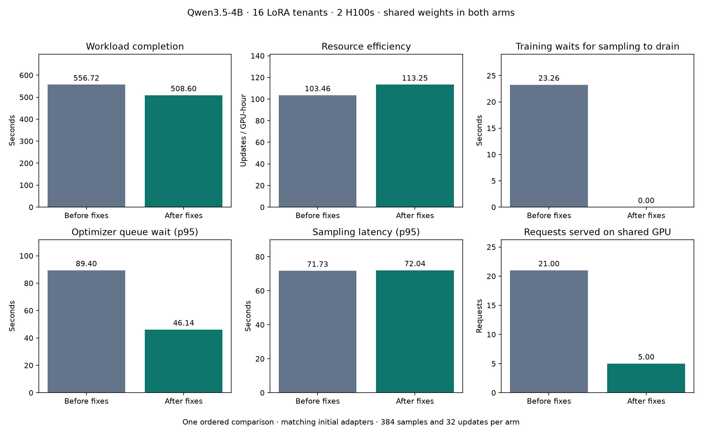
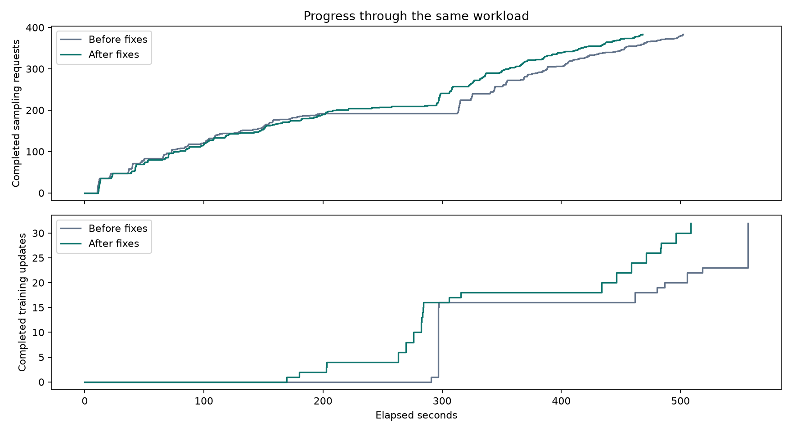
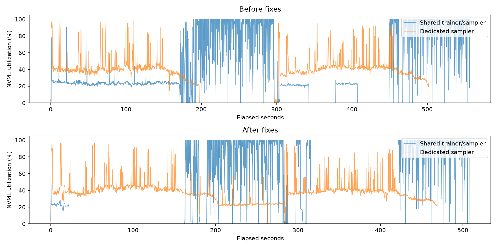

# Borrowing and optimizer queue validation

The fixed scheduler completed this workload in **509 seconds instead of 557**.
Optimizer queue waits and sampling drain delays fell. This is a useful functional
check with an observed performance benefit, but the full time difference is not
an isolated measurement of the scheduler's contribution.

One ordered before/after pair used Qwen3.5-4B, two H100s, the HF training backend,
and 16 LoRA tenants. Each tenant ran three four-turn coding trajectories per
update, for two updates: **384 sampling requests, 96 trajectories and 32 updates
per arm**. Tool tests ran in eight CPU sandboxes. Every trajectory continued for
four turns regardless of task success.

Both arms shared frozen weights. Only the scheduler changed: the baseline used
the preserved pre-fix scheduler, with a shim ignoring the new request-shape
metadata. Both used identical sampling capacities, tasks, seeds, model revision
and code otherwise. Initial adapter fingerprints matched exactly. Initialization,
warmup and final checks are excluded from measured completion time, but included
in the cost estimate.

| Measurement | Before | After |
| --- | ---: | ---: |
| Completion time | 556.7 s | 508.6 s |
| Updates per allocated GPU-hour | 103.5 | 113.3 |
| Optimizer queue p50 / p95 | 25.3 / 89.4 s | 6.3 / 46.1 s |
| Training-update p95 | 140.0 s | 80.3 s |
| Training waits for sampling to drain | 23.26 s | <0.001 s |
| Sampling p95 | 71.73 s | 72.04 s |
| First completed update | 290.6 s | 169.6 s |
| Shared-sampler requests | 21 | 5 |
| Trainer GPU mean utilization | 42.0% | 35.1% |
| Dedicated GPU mean utilization | 29.5% | 34.9% |
| Dedicated GPU samples reporting zero utilization | 28.2% | 8.1% |

The queue recorded 19 bounded priority overtakes. Some tenants could publish their
adapters and restart rollouts while others were still training. The duration gate
recorded 5,186 rejected borrowing decisions (repeated scheduling checks, not unique
requests). All five shared requests after the fixes were cold probes. This
validates conservative training protection; it does **not** demonstrate sustained
borrowing or the accuracy of learned estimates across batch sizes on GPUs.
The [follow-up diagnosis](scheduler-fixes-borrowing-diagnosis.md) identifies the
five-second duration budget and a cross-batch latency fallback error; queued
sampling demand remained available while the shared GPU was idle.

Generated tokens differed by only 0.18% (218,615 versus 218,216), and training
input tokens by 0.12%. No responses hit the output limit. There were no admission
timeouts, scheduler failures or vLLM preemptions. Frozen weights stayed unchanged,
and both arms verified physical sharing with zero copied base parameters. Final
task success was 1/96 versus 2/96; these are system measurements, not evidence of
improved model quality.

The baseline's first measured backward pass took 23.99 seconds versus 6.95 seconds
after the fixes; median backward times were nearly identical (6.40 and 6.41 seconds).
That approximately 17-second discrepancy suggests a startup or cache effect, but
its cause is not isolated. Therefore, do not attribute the entire observed **8.6%
completion-time reduction / 9.5% increase in updates per GPU-hour** to scheduling.
The two fixes were tested together without an ablation. A future comparison should
warm a representative full training batch and balance arm order before making a
stronger speedup claim.

Estimated session cost was **about $4.60**, including warmup and a 20-second failed
GPU startup. The measured GPU-function duration was 25.4 minutes for the completed
pair. Two import/launcher problems were fixed before measurement; the first used
no GPU. There were no repeated measured arms. All containers were stopped after
the pair. See the [cost calculation](scheduler-fixes-cost.json), based on
[Modal pricing](https://modal.com/pricing); it is not an invoice.

The existing CPU suite passed 730 tests with 37 skips, including HF controller and
two-rank FSDP scheduling checks. This run also passed 21 CPU workload/policy
preflight tests. GPU validation here covers HF only; FSDP sharding code was not
changed. Readiness signals and partial rollout support remain out of scope.

[Summary](scheduler-fixes-summary.json) and
[source provenance](scheduler-fixes-provenance.json) are saved alongside the
figures. Raw responses, scheduler traces, engine/GPU telemetry, logs, source
snapshots and runtime records remain under
`runs/scheduler-fixes-20261103T230131Z/` locally and in the
`tuft-shared-weight-experiments` Modal Volume. The offline report is reproducible
with `report_scheduler_fixes.py <run-directory>/comparison.json`.

