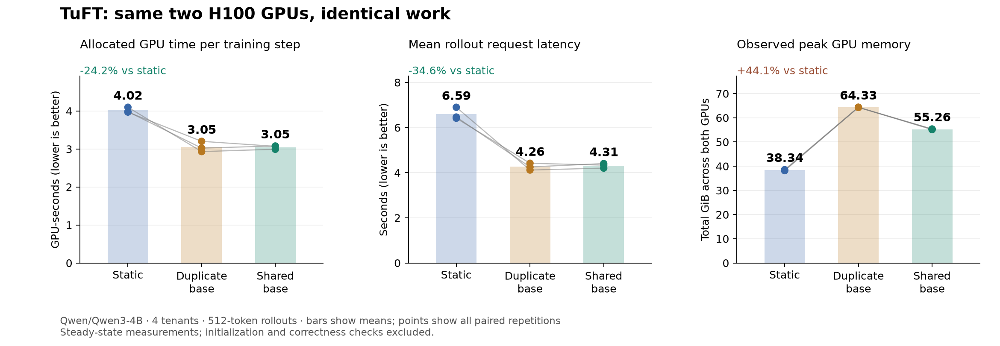
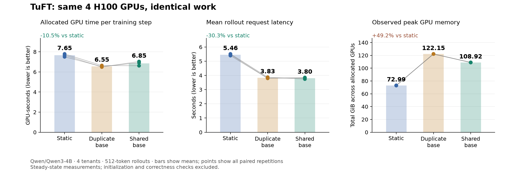
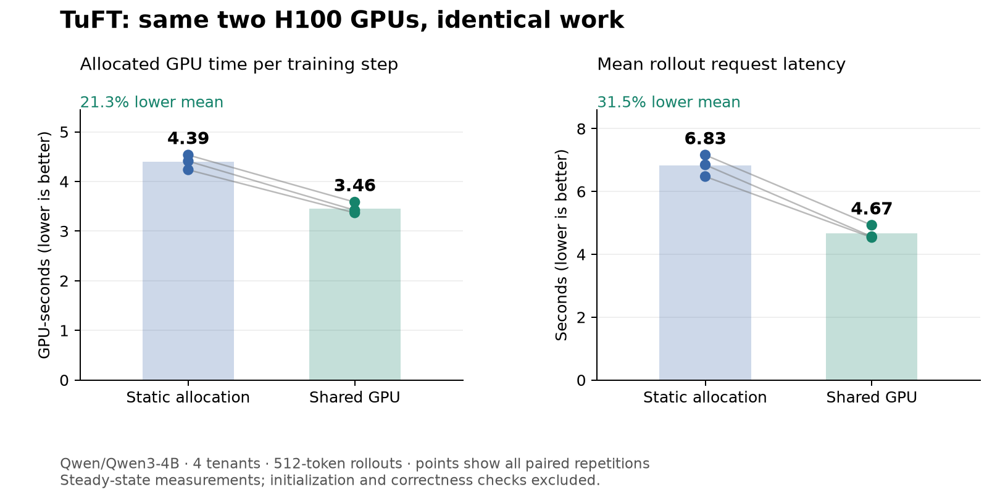

# Historical LoopWeave experiments

This preserves the pre-consolidation experiment report. Duplicate-base borrowing
is retired; its measurements are background evidence, not a supported mode or
a current benchmark baseline. Commands below describe the historical harness.
See [the current report](README.md) for supported configuration and commands.

# LoopWeave adaptation: validation record

The implementation is an opt-in scheduler for the existing HF/FSDP trainers and vLLM
samplers. It preserves tenant adapters, optimizer state, checkpoint publication,
and TuFT's sequence guards. It can borrow the training GPU group between updates;
training closes admission and drains outstanding shared sampling first.

The paper/prototype investigation and iteration history are in
[the work log](../../docs/loopweave-work-log.md). Architecture, configuration,
compatibility and operating limits are in
[the development guide](../../docs/sphinx_doc/source/development/loopweave.md).

## HF shared frozen weights

The opt-in Qwen3 BF16 TP=1 implementation physically aliases the HF
trainer's frozen weights in the colocated vLLM sampler. It uses the existing HF
trainer and published LoRA snapshots, with drain-safe KV reclamation through
vLLM sleep/wake. It requires torch 2.11.0 / vLLM 0.24.0 and an explicit KV budget.
See the [shared-weight configuration](../../config/tuft_config.loopweave.shared.h100.yaml).

Three matched triples on two H100 80GB GPUs, Qwen3-4B and four tenants compare
static allocation, borrowing with duplicate weights, and borrowing with shared
weights. Every sampling replica receives the same explicit 16 GiB KV budget.
Each policy runs first, second and third once. Every run completes **196,608
generated tokens, 12 optimizer steps and eight snapshot publications**.

| Metric | Static | Duplicate base | Shared base |
| --- | ---: | ---: | ---: |
| Allocated GPU-seconds per training step, pooled | 4.017 | 3.052 | **3.047** |
| Mean rollout request latency | 6.593 s | 4.263 s | **4.314 s** |
| Mean of per-run p95 rollout latencies | 7.191 s | 5.081 s | 5.034 s |
| Mean training latency, including admission | 0.962 s | 1.315 s | 1.180 s |
| Observed peak memory, summed across both GPUs | 38.55 GiB | 64.35 GiB | **55.34 GiB** |
| Mean observed memory, summed across both GPUs | 36.01 GiB | 62.10 GiB | 50.83 GiB |

Shared weights achieve **1.294× median paired throughput versus static**
(range 1.294–1.370×), with **24.2% less allocated GPU time per step** and
**34.6% lower mean rollout latency**. Training admission latency is 22.7% higher
than static. Against duplicate-base borrowing, sharing saves **9.01 GiB (14.0%)
of observed peak memory**. Its median paired throughput ratio is **0.982×**
(range 0.980–1.043×); pooled GPU time differs by only 0.17%. Three repetitions
support a memory improvement with comparable throughput, not a sharing-specific
speedup claim. Static still uses the least peak memory because it has one sampler.

| Repeat | Execution order | Static elapsed | Duplicate elapsed | Shared elapsed |
| --- | --- | ---: | ---: | ---: |
| 0 | Static, duplicate, shared | 24.589 s | 17.590 s | 17.955 s |
| 1 | Duplicate, shared, static | 23.894 s | 18.140 s | 18.470 s |
| 2 | Shared, static, duplicate | 23.829 s | 19.208 s | 18.421 s |



[Raw measurements](shared-weights-gpu-Qwen3-4B-512.json) ·
[Machine-readable summary](shared-weights-summary.json) ·
[Modal performance run](https://modal.com/apps/ekzhu67/main/ap-e9cToNRXuwohKzy7xLHcK9)

These are steady-state measurements in normal execution mode, excluding startup,
warmup and correctness probes. NVML is sampled every 200 ms, so memory values are
observed peaks, not guaranteed maxima. The table takes the maximum across all
runs; the figure averages each run's peak. Temporary loader allocations are
excluded. Measured shared runs each had three sleep/wake cycles, averaging
67.2 ms per sleep and 114.0 ms per wake across runs. They had no prediction-window
rejections, so the result measures borrowing, alignment and physical sharing;
it does not establish a benefit from loop prediction. Source and harness digests
in the performance artifact identify the HF implementation at validation time,
before the subsequent FSDP extension.

Both five-round two-H100 GPU integration tests passed: normal execution and
`VLLM_BATCH_INVARIANT=1`. Each completed ten optimizer steps, eight publications,
10,240 generated tokens, and 12 sleep/wake cycles. Checks verified tenant
isolation, checkpoint restoration, trained-snapshot sampling, unchanged base
weights and byte-identical GPU LoRA slots across switching. Each shared **7.492
GiB of unique base storage** and reclaimed **16.207 GiB** while training. The
deterministic test had exactly zero repeat/switch score error.

Default execution is not numerically deterministic: ordinary samplers also
differed, and the shared engine exactly matched a prior ordinary control. A
trained adapter's repeated identical requests varied even without switching;
normal-mode variation is recorded, not hidden by an increased tolerance.
The eager base control was exact. No probability calibration is implemented.

[GPU integration results and JUnit reports](shared-weights-gpu-integration-Qwen3-4B.json) ·
[Final validation record](shared-validation.json) ·
[Numerical control summary](shared-numerical-summary.json) ·
[Compiled controls](diagnostic-shared-weights-gpu-Qwen3-4B-128.json) ·
[Eager controls](eager-diagnostic-shared-weights-gpu-Qwen3-4B-128.json)

Local regression at HF validation: 625 passed, 33 skipped (55.22 s). Scanner
findings for recorded SHA-256 digests and existing placeholders require review;
the baseline was not changed after automatic approval review rejected suppression.

## FSDP shared frozen shards

The FSDP extension preserves sharding of frozen base matrices across training
GPUs. Each colocated vLLM TP rank aliases the matching persistent local shard;
only small normalization weights are replicated. Full layers gathered for
training remain temporary. LoRA parameters, gradients and optimizer state retain
FSDP semantics. The [four-H100 configuration](../../config/tuft_config.loopweave.fsdp.shared.h100.yaml)
uses two FSDP ranks, one fixed TP=2 sampler and one colocated TP=2 sampler.
Compare policies within each backend's experiment: the HF comparison reserves
two GPUs, while the FSDP comparison reserves four. These measurements do not
establish that FSDP is the more efficient trainer for a model that already fits
on one GPU.

Three matched triples on four H100s, Qwen3-4B and four tenants each completed
**196,608 generated tokens, 12 optimizer steps and eight publications** per run.
Every sampling rank received the same explicit 16 GiB KV budget. Normal execution,
CUDA graphs and the workload are identical across policies; startup, warmup and
correctness probes are excluded. Each policy runs first, second and third once.

| Metric | Static | Duplicate base | Shared base |
| --- | ---: | ---: | ---: |
| Allocated GPU-seconds per training step, pooled | 7.654 | 6.553 | **6.852** |
| Mean rollout request latency | 5.458 s | 3.827 s | **3.803 s** |
| Mean of per-run p95 rollout latencies | 5.762 s | 4.522 s | 4.421 s |
| Mean training latency, including admission | 1.520 s | 1.819 s | 2.025 s |
| Observed peak memory, summed across four GPUs | 73.16 GiB | 122.19 GiB | **109.01 GiB** |
| Mean observed memory, summed across four GPUs | 72.88 GiB | 122.07 GiB | 94.87 GiB |

Shared weights achieve **1.091× median paired throughput versus static**
(range 1.086–1.177×), with **10.5% less allocated GPU time per step** and **30.3%
lower mean rollout latency**. Mean training latency is 33.2% higher than static.
Against duplicate borrowing, sharing reduces observed peak memory by **13.18 GiB
(10.8%)** and mean observed memory by **22.3%**, at **4.6% more pooled GPU time**.
Its median paired throughput ratio to duplication is **0.946×** (range
0.922–1.003×). This is a measured memory/throughput tradeoff; static still has the
lowest peak memory. It is not a claim of a universally optimal scheduler.

| Repeat | Execution order | Static elapsed | Duplicate elapsed | Shared elapsed |
| --- | --- | ---: | ---: | ---: |
| 0 | Static, duplicate, shared | 23.361 s | 19.910 s | 19.844 s |
| 1 | Duplicate, shared, static | 22.501 s | 19.604 s | 20.722 s |
| 2 | Shared, static, duplicate | 23.020 s | 19.460 s | 21.099 s |



[Raw measurements](fsdp-shared-Qwen3-4B-repeats-3.json) ·
[Machine-readable summary](fsdp-shared-summary.json) ·
[Modal performance run](https://modal.com/apps/ekzhu67/main/ap-l7zGoJ4H7Gs8GTBnwdk7So).

Both ranks verify physical aliases with **7.493 GiB** of unique base storage
in total and zero copied base parameters. Training releases **32.332 GiB** of
sampler memory. Every run preserves base hashes and GPU adapter bytes through
switching. Each timed shared run has three group sleep/wake cycles, averaging
56.7 ms per sleep and 117.6 ms per wake. There are no prediction-window rejections;
this workload establishes borrowing and sharing benefits, not a measured benefit
from loop prediction. All nine runs passed tenant-isolation, checkpoint and
published-snapshot checks, with finite losses and equal per-tenant token counts.
Source and harness fingerprints match the final tested implementation.

NVML is sampled every 200 ms. The table uses the maximum observed total across
runs; the figure averages each run's peak. Observed memory savings include
allocator/cache effects, so they are distinct from the verified aliased bytes.
Budgets and admission limits are held fixed for comparison, not tuned to a
memory/throughput frontier. Full-model FSDP startup allocations and temporary
sampler loader allocations are excluded from steady-state measurements.

The Qwen3-only two-H100 storage probe passed in **23.02 s** at that stage. It compared exact forward
values and LoRA gradients with ordinary FSDP across three optimizer steps and
alternating adapters; it checks real DTensor sharding, stable base pointers and
hashes, and release of full initialization parameters before cache cleanup.
Its old local result was superseded by the expanded three-architecture probe:
[current storage probe evidence](fsdp-shards-validation.json), **3 passed in 153.84s**.

Full Qwen3-0.6B FSDP/TP=2 integration passed on four H100s in **318.38 s**, including
startup: ten optimizer steps, eight publications, 10,240 generated tokens and
12 group sleep/wake cycles. Both ranks verified aliases, totaling **1.110 GiB**
of unique base storage, with **32.180 GiB** reclaimed during training. Frozen base
and GPU adapter bytes were preserved; deterministic repeat/switch score errors
were zero. Both HF regression modes also passed after the multi-rank loader
extension. These integration artifacts precede the final FSDP failure guard and
startup cleanup; the final storage probe covers cleanup, and the local suite
covers fail-closed group reuse.

[FSDP integration evidence](fsdp-shared-Qwen3-0.6B-repeats-0.json) ·
[HF integration regressions](shared-weights-gpu-integration-Qwen3-0.6B.json).

The local regression suite at Qwen3 FSDP validation passed **635 tests, 34 skipped** in **51.75 s**.
Pinned lint, formatting and isolated type checking passed for all changed and
new Python files. [Combined validation record](dual-backend-validation.json).

## Earlier duplicate-base performance results (historical)

The results in this section predate physical sharing: "Shared GPU" means a
second resident base-model copy borrowing compute. Its automatic cache budgets
differ from the explicit 16 GiB budgets in the new comparison. Do not compare
absolute times or memory between these experiments as an implementation-only gain.

Three matched pairs on two H100 80GB GPUs, Qwen3-4B, four tenants and 512-token
rollouts improved throughput by **1.265× median paired speedup** (range
1.257–1.289×). Every run produced 196,608 tokens and completed 12 training steps
plus eight publications. These are steady-state results for this workload, not
an assertion that all deployments improve.

| Metric | Static allocation | Shared GPU | Change |
| --- | ---: | ---: | ---: |
| Allocated GPU-seconds per training step, pooled | 4.392 | 3.457 | **21.3% lower** |
| Mean rollout request latency | 6.828 s | 4.675 s | **31.5% lower** |
| Mean of per-run p95 rollout latencies | 7.449 s | 5.772 s | 22.5% lower |
| Mean training latency, including admission | 1.453 s | 1.659 s | **14.2% higher** |
| Mean NVML GPU busy percentage | 39.4% | 64.4% | +25.0 percentage points |
| Peak resident memory per GPU, NVML order | 11.95 / 73.05 GiB | 48.64 / 72.84 GiB | More shared-GPU memory |

| Pair | Execution order | Static elapsed | Shared elapsed | Throughput ratio |
| --- | --- | ---: | ---: | ---: |
| 0 | Static, shared | 27.196 s | 21.501 s | 1.265× |
| 1 | Shared, static | 25.406 s | 20.205 s | 1.257× |
| 2 | Static, shared | 26.451 s | 20.521 s | 1.289× |



[Raw measurements](gpu-Qwen3-4B-512.json) ·
[Machine-readable summary](final-summary.json) ·
[H100 configuration](../../config/tuft_config.loopweave.h100.yaml)

The timed code is commit `26afb88`; its source and harness hashes are in the raw
file. Follow-up fixes preserve legacy persistence signatures and estimate
concurrent service rate by busy interval. The timed three-round runs had zero
window rejections: this comparison demonstrates GPU borrowing and rollout
alignment, not a measured benefit from learned loop prediction. A separate
five-round GPU test validates the final source after those fixes. Runtime:
torch 2.11.0+cu130, vLLM 0.24.0, transformers 5.19.0, Python 3.12.13.

## Workload and measurement method

Within each comparison all policies receive the same GPU count: two H100s for HF,
four for FSDP/TP=2. Static allocation uses one training group and one vLLM sampler
group. Both borrowing policies use the same trainer and fixed sampler, plus a
second vLLM engine resident on the training GPUs. All policies use the same model,
LoRA rank, training examples, rollout token budget and CUDA-graph setting within
each pair. The baseline is TuFT's existing `round_robin` execution path.

Four independent users each execute three sample/train/publish rounds. Every
round performs forward/backward and an optimizer step. Updated sampling snapshots
are published between rounds: 12 training steps and eight publications per run.
The final throughput workload requests 32 samples per user per round, each with a
32-token prompt and 512 generated tokens: **196,608 output tokens per run**.
Training uses four 64-token sequences per step. This synthetic loop verifies
serving/training functionality and throughput, not RL task quality.

Startup, model loading, CUDA-graph capture, warmup, and explicit correctness
checks are outside the timing interval. Both base and nonzero-LoRA paths are
warmed on every engine. Timing includes sampling, training, checkpoint export and
publication of updated adapters. Policy order is balanced across repetitions.
Raw results include full configuration, model revision, dependency versions,
source and harness fingerprints, every 200 ms NVML observation, per-tenant losses,
latencies, and scheduler counters from the measured interval.

GPU-seconds = allocated GPU count × elapsed seconds. This is resource reservation
cost within the timed loop, not the total bill for the validation job, measured
kernel execution time, or power consumption. NVML busy
percentages and overlapping request-seconds are not substitutes for throughput.

## Earlier iterations (retained, including regressions)

Each row compares matched policies within that experiment. Different rows have
different workloads or execution settings; do not compare their elapsed times as
an implementation-only improvement.

| Experiment | Static seconds | Shared seconds | Throughput ratio | Raw data |
| --- | ---: | ---: | ---: | --- |
| 0.6B, eager, small wave, limits 16/8 | 18.240 | 26.906 | 0.678× | [JSON](gpu-pilot-constrained.json) |
| 0.6B, eager, limits 32/16 | 21.779 | 22.055 | 0.987× | [JSON](gpu-pilot-tuned.json) |
| 4B, eager, updated snapshots, before alignment | 25.010 | 30.051 | 0.832× | [JSON](gpu-4b-before-alignment.json) |
| 4B, eager, bounded alignment | 28.378 | 32.450 | 0.875× | [JSON](gpu-4b-aligned-eager.json) |
| 4B, CUDA graphs, 32 samples/user, 128 output tokens | 11.516 | 11.013 | 1.046× | [JSON](gpu-4b-throughput-pilot.json) |

The first two pilots held the initial sampling snapshot throughout timing. Later
runs publish trained adapters between rounds. The eager pilots used eight CPU
cores; the CUDA-graph throughput runs reserve 16 and set OpenMP/MKL threads to one
per process, identically for both policies. The 128-token graph pilot is a single
pair and is not evidence of a statistically established 4.6% gain.

The pilots exposed insufficient admission capacity, rollouts routed entirely to
the fixed sampler during the post-training quiet interval, and first-use LoRA
compilation inside measurements. The implementation/harness corrections and
regression tests are recorded in the work log. GPU sharing remains workload
sensitive; adding a resident sampler does not guarantee better efficiency.

## Historical correctness and regression checks

The full local test suite passed **614 tests**, with **32 GPU tests skipped**.
Repository hooks passed lint, formatting, isolated type checking, tests and secret
scanning. The final five-round two-H100 integration test also passed: ten training
steps, eight publications and 10,240 output tokens. Its source fingerprint matches
final implementation commit `5bd0005`. See [GPU test evidence](gpu-integration.xml)
and [runtime metadata](gpu-integration-Qwen3-4B.json).
[Validation metadata](validation.json) also records the earlier 604-test
CPU selection and 38 focused scheduler/adapter/controller tests; these overlap
and must not be summed.

The focused tests cover queue capacity and 429 errors, timeouts, tenant FIFO and
fair admission, token-work routing, failure cleanup, cancellation after dispatch,
exactly-once sequence advancement for cancelled optimizer calls, drain-safe
shutdown, physical placement checks, loop prediction, bounded rollout alignment,
HTTP routing, and conservative zero-adapter verification.

Historical GPU correctness assertions verified that a real optimizer update changes one
user's LoRA weights while another user's weights stay identical, optimizer
checkpoint restoration restores the original adapter, a trained snapshot can be
published and sampled, nonzero snapshots retain their adapter path, and verified
zero snapshots match the normal adapter's greedy tokens/log probabilities.
Current checks use identical teacher-forced histories for zero-adapter comparisons.
Correctness checks run before every measured policy. Zero-adapter comparisons apply to
the opt-in policy, where that optimization exists.

## Reproduction

From this checkout, with Modal configured:

```bash
modal run scripts/benchmark_loopweave_modal.py --repeats 3 \
  --model Qwen/Qwen3-4B --output-tokens 512 --shared-weights --validate-tests
python scripts/summarize_loopweave.py \
  benchmarks/loopweave/shared-weights-gpu-Qwen3-4B-512.json \
  --output benchmarks/loopweave/shared-weights-summary.json
TMPDIR=/tmp RAY_TMPDIR=/tmp uv run pytest
```

The Modal job is ephemeral and deploys no service. It builds the checkout's
runtime dependencies over the published TuFT image and removes the old incompatible
FlashAttention wheel. The harness records the actual torch/vLLM/transformers
versions; they must be considered when comparing a future rerun.
Use `--repeats 0 --shared-weights --validate-tests` to run only the current
five-round GPU integration tests in deterministic and normal modes. Optional
`TUFT_MODAL_CACHE_VOLUME=<dedicated-volume-name>` caches only compiler artifacts.
The three-policy comparison rotates order across three repetitions. Recreate its chart with:

```bash
uv run --no-project --with matplotlib python scripts/plot_loopweave.py \
  benchmarks/loopweave/shared-weights-gpu-Qwen3-4B-512.json \
  --output benchmarks/loopweave/shared-weights-performance.png
```

For FSDP sharding and real TP=2 sampling, use:

```bash
modal run scripts/verify_fsdp_shared_modal.py
modal run scripts/verify_fsdp_shared_modal.py --full --repeats 0
modal run scripts/verify_fsdp_shared_modal.py --full --repeats 3 \
  --model Qwen/Qwen3-4B --no-validate-tests
python scripts/summarize_loopweave.py \
  benchmarks/loopweave/fsdp-shared-Qwen3-4B-repeats-3.json \
  --output benchmarks/loopweave/fsdp-shared-summary.json
uv run --no-project --with matplotlib python scripts/plot_loopweave.py \
  benchmarks/loopweave/fsdp-shared-Qwen3-4B-repeats-3.json \
  --output benchmarks/loopweave/fsdp-shared-performance.png
```

The storage probe uses two H100s; full integration and performance comparisons
use four. The separate integration command defaults to Qwen3-0.6B and deterministic
execution. The performance command uses normal execution and runs the same
correctness probes before every policy, outside timing.

## Limits

GPU borrowing supports one base model and at least one persistent sampler group.
HF requires TP=1. FSDP requires matching FSDP/TP sizes and a single-node training
group; real-engine sharing was validated at FSDP=TP=2. Frozen FSDP base matrices
remain sharded; only small normalization and router weights are replicated. Without the
shared-weight option, both base copies and the KV
pool remain resident. Physical sharing supports unquantized Qwen3 and the
Qwen3.5 dense/MoE architecture in BF16, with the coverage detailed below and
validated even head/projection/vocabulary partitions;
startup still needs temporary destination allocations (and FSDP's existing full
model initialization per rank), and producer
failure requires a backend restart. Dynamic FSDP repartitioning is not implemented.
OpenAI HTTP traffic stays on fixed replicas
and is not included in token-work routing estimates. Unexpected training waits
for admitted shared samples to finish; there is no hard wall-clock latency bound.
The server does not change log probabilities or infer acceptable policy staleness.

### Hybrid Qwen validation

The Qwen3 measurements above predate the hybrid dense/MoE extension. Current
coverage is tracked in `docs/loopweave-work-log.md`; do not extrapolate those
throughput ratios to Qwen3.8-27B or Qwen3.6-35B-A3B.
`qwen-validation.json` records the current product-source digest, per-artifact
digests, model revisions, test counts and numerical limits. All listed checks pass.

`qwen-vllm-layout-validation.json` records real dense/GDN-only and MoE/expert-only
adapter tests, complete base aliases, and exact sleep/wake token/log-prob checks.
The expanded `fsdp-shards-validation.json` now covers all three architectures
with production activation checkpointing and real 128-wide GDN heads.

The full checkpoint harness is:

```sh
modal run scripts/verify_qwen_shared_modal.py --model Qwen/Qwen3.8-27B --backend hf --repeats 1
modal run scripts/verify_qwen_shared_modal.py --model Qwen/Qwen3.8-27B --backend fsdp
modal run scripts/verify_qwen_shared_modal.py --model Qwen/Qwen3.6-35B-A3B --backend hf
modal run scripts/verify_qwen_shared_modal.py --model Qwen/Qwen3.6-35B-A3B --backend fsdp --repeats 1
```

HF uses two B200s; FSDP uses four H200s with TP=2. Policy comparisons within each
run use identical GPU types, text-only backbones, 4-GiB KV budgets per rank,
Triton prefill/MoE kernels and 128 output tokens. These runs target functionality
and bounded performance evidence, rather than paper reproduction. Model revisions,
runtime versions, source/harness hashes and raw measurements are saved per run.

The first Qwen3.8-27B HF triple completed equal work (12 steps, 49,152 output
tokens, 8 publications per policy):

| Policy | GPU-seconds / step | Mean rollout latency (s) | Observed peak GiB, both GPUs |
| --- | ---: | ---: | ---: |
| Static | 10.906 | 11.714 | 127.892 |
| Duplicate base | 8.110 | 5.537 | 178.411 |
| Shared base | 7.364 | 5.266 | 123.257 |

This is **one paired comparison**, not a confidence interval or a universal
speedup. Shared mode uses 32.5% less allocated GPU time than static and 9.2%
less than duplicate mode in this run, while the observed peak is 55.15 GiB
below duplicate mode. Initialization and correctness probes are excluded.
The figure is `qwen38-27b-hf-performance.png`; the derived data is
`qwen38-27b-hf-summary.json`. Comparisons match token/request budgets and
training data; generated token identities and LoRA initialization are not
held identical across actor restarts. Normal inference also has reduction-order
variation. Larger timing studies would require additional repetitions.

The Qwen3.6-35B-A3B FSDP triple also completed equal work (four H200s,
12 steps, 49,152 output tokens and 8 publications per policy):

| Policy | GPU-seconds / step | Mean rollout latency (s) | Observed peak GiB, four GPUs |
| --- | ---: | ---: | ---: |
| Static | 21.854 | 10.427 | 245.488 |
| Duplicate base | 25.312 | 6.210 | 335.079 |
| Shared base | 25.689 | 6.186 | 223.174 |

This single comparison is a **memory/latency improvement with a throughput
regression**. Shared mode reduces observed peak memory by 111.90 GiB (33.4%)
versus duplicate mode and by 22.31 GiB versus static. Rollout latency is 40.7%
below static, but GPU time is 17.5% above static and 1.5% above duplicate.
Mean training request latency rises from 3.874s (static) to 4.895s (duplicate)
and 5.484s (shared). This includes queueing; it is not isolated kernel time.
The shared group's 40 serialized operations occupy 66.04s of the 77.07s run;
five sleep/wake pairs account for 2.48s. Per-request waits overlap and must not
be summed into an additional wall-clock cost.

The data does not establish a fundamental tradeoff limit. Avoiding borrowing
when training/publication dominates, reducing expert-weight permutation work,
and combining adjacent training/publication operations are plausible next
improvements. They need targeted measurements before claiming a benefit. The
default remains opt-in: this short-rollout MoE workload should use static
scheduling when throughput is the priority and its memory footprint fits.
Use shared mode when its lower memory footprint or rollout latency is worth
the observed throughput cost. Dense and historical Qwen3 gains do not imply
that every workload benefits from borrowing.
The MoE figure and summary are `qwen36-35b-fsdp-performance.png` and
`qwen36-35b-fsdp-summary.json`.

Full Qwen3.8-27B and Qwen3.6-35B-A3B integrations pass on both HF and FSDP,
each including 10 steps, 8 publications, checkpoint restoration and tenant isolation.
Dense FSDP shares 50.10 GiB of unique frozen-base storage; MoE HF and FSDP
share 64.56 and 64.60 GiB respectively, with zero copied base parameters.
The MoE FSDP integration passed in 573.31s. Normal FSDP inference is not
bitwise deterministic: its trained repeat/switch/cache-reset differences are
recorded in the raw artifact and manifest. The separate strict HF controls below
establish exact switching for their tested kernel configuration.

Final local validation: **640 passed, 38 GPU-only tests skipped**. Separate GPU
probes pass 3 FSDP storage/gradient tests and 2 real-vLLM hybrid layout tests.
The full-checkpoint artifacts contain 7 passing integration runs (four large
model/backend combinations, two additional strict controls, and the small dense
hybrid check). Repository-pinned lint, formatting and type checks pass.

The hybrid harness uses `sampling_max_num_seqs=64` and
`VLLM_USE_AOT_COMPILE=0`; compiled inference and CUDA graphs remain enabled.
Large trained models show ordinary repeated-score variation, so strict numerical
controls additionally select shrink `split_k=1` through vLLM's published
[tuned-configuration interface](https://github.com/vllm-project/vllm/blob/v0.24.0/vllm/lora/ops/triton_ops/utils.py)
(`VLLM_TUNED_CONFIG_FOLDER`). This control does not alter returned
probabilities or require unsupported batch-invariant GDN attention:

```sh
modal run scripts/verify_qwen_shared_modal.py --model Qwen/Qwen3.8-27B \
  --backend hf --label single-split --single-split-lora
modal run scripts/verify_qwen_shared_modal.py --model Qwen/Qwen3.6-35B-A3B \
  --backend hf --label single-split --single-split-lora
```

Both strict controls passed on two B200s. Ordinary-sampler repeats, shared-sampler
repeats, cache reset, and all three cold-cache sleep/wake transitions had **exactly
zero** prompt log-probability difference on both checkpoints. Adapter bytes also
remained unchanged. These are fixed-history, same-engine checks, not a guarantee
of invariance across different batch shapes. Normal kernels showed repeated-score
variation even without switching; their raw scores remain in the artifacts.

The figure `qwen-numerical-controls.png` and `qwen-numerical-summary.json` record
these separate controls. The exact measured tuning file is saved as
`lora-kernels/NVIDIA_B200_SHRINK.json`; to reproduce this option locally, point
`VLLM_TUNED_CONFIG_FOLDER` at that directory before starting workers. It was tested
with rank-8 LoRA on B200; it is not a general performance recommendation, and the
normal-kernel throughput figures do not measure its cost. The dense numerical
control permits an H200 pair if B200s are unavailable; its actual GPU type is recorded.
Use `--revision` with the model commit recorded in each result for a pinned rerun.
Deployment examples are
`config/tuft_config.loopweave.shared.qwen_dense.b200.yaml` and
`config/tuft_config.loopweave.fsdp.shared.qwen_moe.h200.yaml`.

Recreate the hybrid figures from saved data:

```sh
uv run --no-project --with matplotlib python scripts/plot_loopweave.py \
  benchmarks/loopweave/qwen-shared-hf-Qwen3.8-27B-repeats-1.json \
  --output benchmarks/loopweave/qwen38-27b-hf-performance.png
uv run --no-project --with matplotlib python scripts/plot_loopweave.py \
  benchmarks/loopweave/qwen-shared-fsdp-Qwen3.6-35B-A3B-repeats-1.json \
  --output benchmarks/loopweave/qwen36-35b-fsdp-performance.png
uv run --no-project --with matplotlib python scripts/plot_loopweave_numerics.py \
  benchmarks/loopweave/qwen-numerical-summary.json \
  --output benchmarks/loopweave/qwen-numerical-controls.png
```
