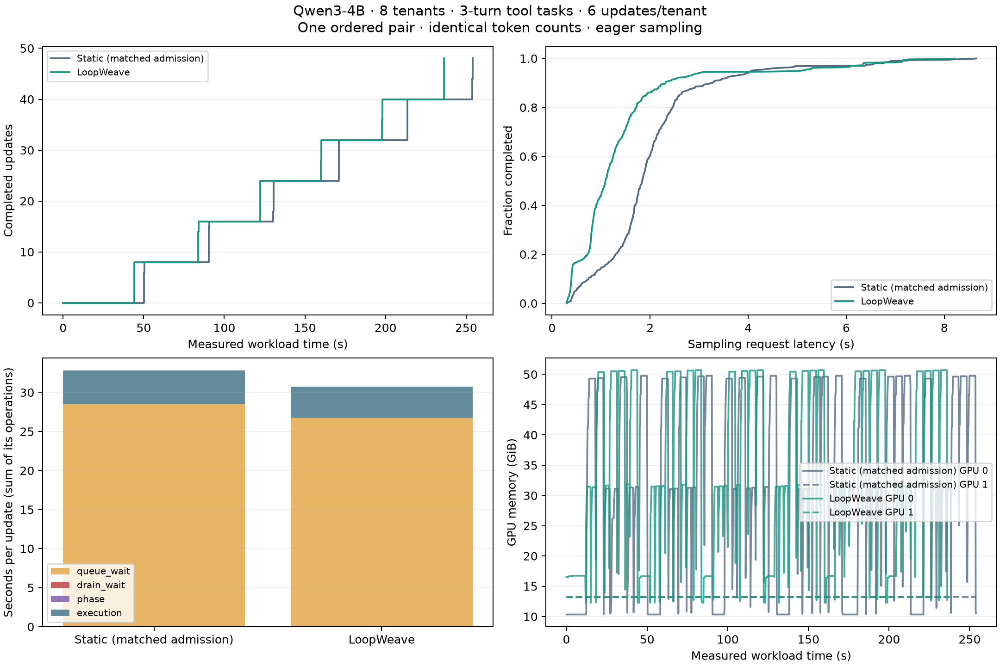
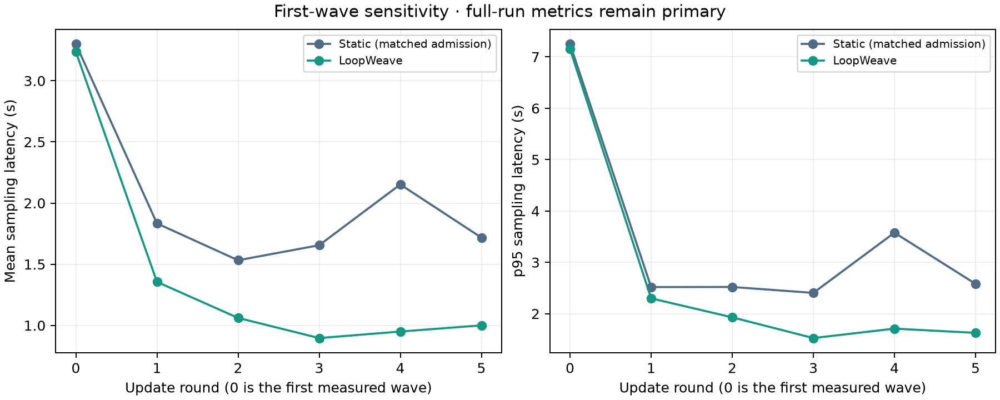

# Long-context multi-tenant agent validation

The corrected LoopWeave system completed this one ordered pair in **236.319 s**,
versus **254.052 s** for a static pool with matched admission and batching:
**6.98% less allocated GPU time per update**, or 7.50% more updates/second.
Both arms completed the same token work with 100% tool and decision success.
Full-run sampling p95 worsened 24.62%; this is a throughput/latency tradeoff,
not a universal improvement or a statistically established scheduler-only gain.

Started 2026-10-17 and finished 2026-10-18 UTC. Product code: `8a2de3f`;
corrected benchmark/preflight: `be7f0e1`. No successful experiment was repeated.

## Workload and controls

- Two H100 80GB GPUs; one Qwen3-4B base, eight tenants with independent rank-8
  LoRA adapters, six updates per tenant, four trajectories per update.
- Each trajectory makes two allowlisted warehouse-policy/stock lookups followed
  by a ship/hold decision. Actual model outputs select tools; tool observations
  become subsequent conversation context. Simulated tool latency varies from
  50 ms to 1.6 s. Invalid actions return error observations.
- Contexts: 1,781–3,604 tokens, including reference documents and accumulated
  conversation. Each arm processed 1,552,480 prompt tokens and 6,472 generated
  tokens across 576 requests and 192 trajectories. These are short JSON actions
  with long inputs, not a long-generation coding/reasoning workload.
- Actual generated tokens and sampling log probabilities feed importance-sampling
  updates with terminal reward minus a fixed 0.5 baseline. Prompt advantages are
  zero. Training uses each turn as a separate example, repeating its context;
  this is more compute-intensive than packing a whole trajectory once. It tests
  causal agent training, not learning convergence or optimized trajectory packing.
- Both arms use Fixed admission 16, maximum active LoRAs 4, 4 GiB KV cache per
  sampler, eager sampling, and identical workload seeds. Static uses `balanced`
  so queueing and adapter batching match. LoopWeave adds a shared sampler with
  at most four active requests and an explicit 8,192-token request/probe cap.
  No duplicate-base borrowing arm exists.
- Fresh processes per arm, static first. Warmup exercises nonzero adapters and
  small training/sampling shapes, not every measured long-context/batch shape.
  Adapter initializations are independent. Natural generations could differ,
  though observed prompt/output counts and task success matched exactly.
- Runtime: torch 2.11.0, vLLM 0.24.0, Transformers 5.19.0, Tinker 0.25.0,
  PEFT 0.20.0. Initialization and warmup are excluded from performance timing
  and included in the compute-cost ledger.

## Primary measured results

| Metric | Static, matched admission | LoopWeave |
| --- | ---: | ---: |
| Completed updates | 48 | 48 |
| Measured wall time | 254.052 s | 236.319 s |
| Allocated GPU-seconds/update | 10.585 | 9.847 |
| Updates/second | 0.18894 | 0.20312 |
| Mean sampling latency | 2.032 s | 1.417 s |
| Sampling p95 | 4.072 s | 5.075 s |
| Episode p95 | 11.360 s | 11.536 s |
| Mean backward+optimizer latency | 32.788 s | 30.763 s |
| Mean checkpoint+publication latency | 1.168 s | 1.609 s |
| Peak memory on one GPU | 49.755 GiB | 50.705 GiB |
| Mean NVML GPU activity, training GPU | 68.05% | 75.76% |
| Mean NVML GPU activity, dedicated sampler | 4.90% | 5.12% |
| Valid tool calls / correct decisions | 100% / 100% | 100% / 100% |



## What the new telemetry establishes

- Flex completed **90/576 requests**; Fixed completed 486. There were nine
  serial cold calibration probes, 82 profitable-candidate evaluations and 1,087
  cost rejections. These evaluation counters are not distinct request counts.
  Calibration rates update when a replica's busy interval drains; continuously
  busy traffic can therefore remain conservatively calibrated for longer.
- **No training or publication drain events occurred.** Summed measured waits
  on the already-set drain event were under 0.2 ms per category. The new
  queue/drain distinction rules out blocked training behind Flex in this run.
- Training service: 202.324 s static versus 190.376 s LoopWeave. Training lock
  queue waits sum to 1,371.250 versus 1,285.489 s across callers; those sums
  overlap and are **not wall time or GPU busy time**.
- LoopWeave exclusive maintenance service was 9.551 s, versus 5.826 s static.
  This includes checkpoint and colocated registration. Persistent registration
  proceeds outside the training gate. LoopWeave training phase transitions
  took 0.588 s. Publication still has a measurable latency cost.
- Both arms recorded 48 completed-loop observations and eight eligible histories
  at the end. LoopWeave rejected 16 infeasible local plans and applied no planned
  holds. This workload does **not** demonstrate a fast-planner performance gain;
  the planner changes are covered by CPU regressions.
- Both frozen bases remained unchanged. Shared unique storage was
  **8,044,936,192 bytes**; copied base parameters and bytes were both zero.
  Aliased parameter bytes can exceed unique storage because of tied weights.

The 11.948 s difference in measured training service is a large part of the
17.733 s wall-time difference. This pair does not isolate scheduling from storage
layout, warmup, run order, or execution variability. It supports an observed
whole-system gain under these settings, not attribution of all gains to borrowing.

## First-wave sensitivity, without replacing the primary result

The first measured long-context wave has a broad latency tail in both arms.
An exploratory breakdown of rounds 1–5 gives sampling p95 of 2.813 s static
versus 1.937 s LoopWeave. Time from each arm's last first-update completion to
its final completion is 203.690 versus 192.082 s, a 5.70% difference. These are
post-hoc subsets of the same run, not independent trials. The full-run p95
regression above remains the primary tail-latency result.



## Changes and validation

Every Flex admission now rechecks cost including reserved work; calibrated
routing uses completion estimates. Reactive alignment cannot strand idle Fixed
capacity. The planner isolates distant groups and includes recent checkpoint /
colocated-publication service. Publication-only wakes do not reset training dwell.
Fixed registration no longer holds the training gate; shared registration and
rollback retain exclusion. Compound transactions drain on disconnect and shutdown.

New telemetry separates queue, drain, phase and service time, explains profile
eligibility, and optionally records a bounded identifier-free trace. Failed
exclusive operations contribute to occupancy but not successful-service records.

Targeted CPU suite: **162 passed, one skipped**, including FSDP group/storage
regressions. Four additional tokenizer/CLI tests passed, and all repository
commit checks passed. FSDP changes only classify checkpoint telemetry; frozen-base
sharding, rank mappings and collectives are unchanged. This iteration did not
repeat FSDP, multi-base, large-Qwen, MoE, or numerical-calibration GPU experiments.
Those coverage limits remain distinct from the eight-adapter HF test here.

## Spending and artifacts

Estimated requested-resource compute for this iteration: **$2.640**, including
both failed starts ($0.522) and the successful pair ($2.118). Rates were checked
against [Modal pricing](https://modal.com/pricing): two H100s plus 16 CPU cores
and 64 GiB RAM total $0.00254568/s. Windows include initialization through app
stop; the first failed attempt conservatively uses app creation as its start.
Actual CPU/RAM usage above requests, credits and egress can change the invoice.
All three validation apps are stopped; the final container list was empty.

The failures occurred before measured requests: a helper-import namespace
collision (30.87 function seconds), then Transformers' default BatchEncoding
return (162.71 function seconds). Both have regression coverage. The corrected
launcher validates actual tokenizer/request/target shapes before model startup.

- [Raw successful pair](agents-multiturn-final-20261017.json)
- [Summary](agents-multiturn-final-20261017-summary.json),
  [sensitivity data](agents-multiturn-final-20261017-sensitivity.json)
- [Main PNG](agents-multiturn-final-20261017.png) /
  [SVG](agents-multiturn-final-20261017.svg)
- [Latency PNG](agents-multiturn-final-20261017-latency-rounds.png) /
  [SVG](agents-multiturn-final-20261017-latency-rounds.svg)
- [Cost ledger](agents-cost-20261017.json), [CPU JUnit](agents-cpu-junit.xml),
  [tokenizer preflight](agents-tokenizer-preflight.json)
- Failed starts: [import](agents-multiturn-20261017.json),
  [tokenizer contract](agents-multiturn-retry-20261017.json)

Reproduction (paid; do not rerun merely to recreate the figures):

```bash
.venv/bin/modal run scripts/validate_loopweave_agents_modal.py --label UNIQUE_LABEL
```

Offline plotting:

```bash
uv run --no-project --with matplotlib python scripts/report_loopweave_agents.py \
  benchmarks/loopweave/agents-multiturn-final-20261017.json
```
