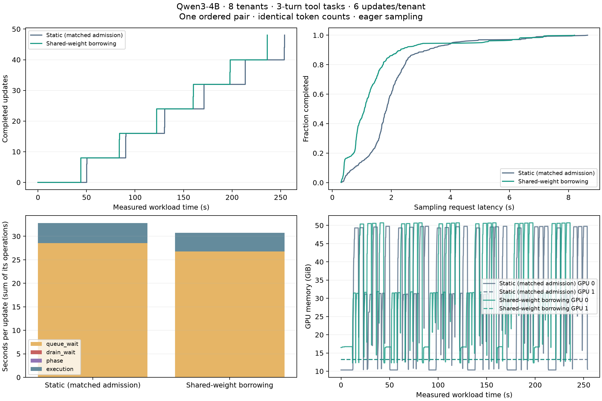
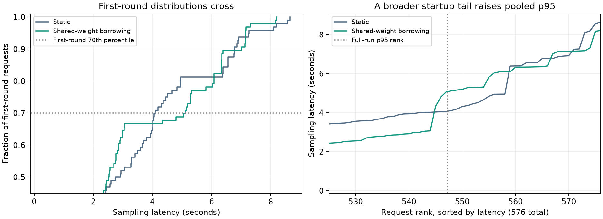

# Shared-weight milestone: saved results

These saved measurements were collected before the PR was extracted, not from a
new GPU run of this branch. Policy labels were renamed; measurements are unchanged.
The predictive planner applied no holds in this run and is excluded from this PR.
The saved `infeasible_plans` counter belongs to that excluded component.
The extraction also disables reactive alignment by default (it was already zero
in this experiment). No performance change from the extraction is claimed.

## Agent workload

Two H100 80GB GPUs, Qwen3-4B, eight tenants with independent rank-8 adapters,
six updates each, four trajectories per update and three turns per trajectory.
Each trajectory performs policy and stock lookups, then a shipping decision.
Contexts start near 1.8k or 3.5k tokens depending on the tenant; measured prompts
range from 1,781 to 3,604 tokens. Outputs are short JSON actions.
Tool results feed later prompts, and generated tokens feed real LoRA updates.

The static control uses the same Fixed admission and batching. Shared-weight borrowing adds
sampling on the training GPU using shared weights. Both arms completed 48 updates,
192 episodes and 576 requests, with identical prompt/output token counts and
100% tool/decision success. Both used eager execution.

| Metric | Static | Shared-weight borrowing |
| --- | ---: | ---: |
| Wall time | 254.052 s | 236.319 s |
| Allocated GPU-seconds/update (2 × wall time / updates) | 10.585 | 9.847 |
| Mean sampling latency | 2.032 s | 1.417 s |
| Sampling p95 | 4.072 s | 5.075 s |

Allocated GPU time/update fell **6.98%**, equal to the wall-time reduction because
both arms reserved two GPUs. This is not measured GPU utilization.
Mean sampling latency fell **30.28%**.
P95 rose **24.62%**. Shared storage checks found 8,044,936,192 unique base bytes,
zero copied base parameters, and unchanged frozen-weight hashes.

## Startup tail and limits

All 29 requests above Shared-weight borrowing's pooled p95 were first-turn requests in the
initial round. Later-round p95 was 1.937 s versus 2.813 s static. Warmup bypassed
scheduler calibration, and Fixed's initial service was slower. Flex performed
nine serial cold probes while waiting for Fixed to drain. Training, publication
and planner holds did not cause these outliers.

The next work is sustained-load calibration, correlated engine timing, and
representative warmup. The saved telemetry cannot establish why Fixed's initial
service was slower. Do not hide startup by dropping round 0 from the primary result.

This is one ordered pair with one base model, not a production fleet study or a
statistical guarantee. Training service also improved, so the wall-time gain
cannot all be assigned to scheduling. The workload verifies system behavior,
not learning convergence or training/inference numerical equivalence.

## Reproduction and provenance

- [Saved telemetry](agent-telemetry.json), with neutral policy labels.
- Local summaries: `agent-results.json` and `startup-tail.json`.
- Workload: `scripts/benchmark_shared_weight_agents.py`; figure generation:
  `scripts/report_shared_weight_agents.py` on the saved telemetry. Startup-tail
  analysis: `scripts/diagnose_shared_weight_agent_tail.py`.
- Existing GPU integration tests cover shared storage, adapter isolation,
  publication, phase changes, and FSDP shard/gradient equivalence. They require
  explicit `--gpu`; no GPU experiments were run when creating this PR.

PR validation after two Claude review rounds: **695 passed, 37 skipped** in the full CPU suite on
2026-10-25. GPU tests remained disabled; persistence tests used FileRedis.
