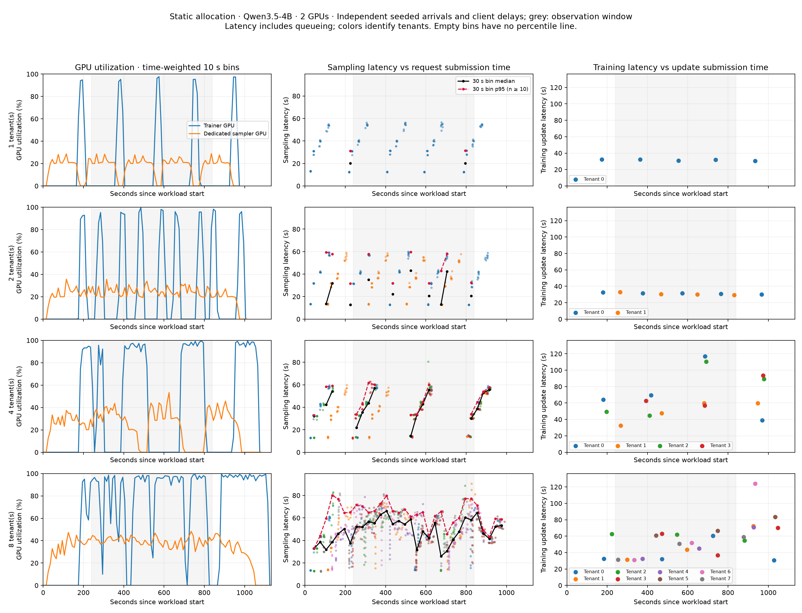
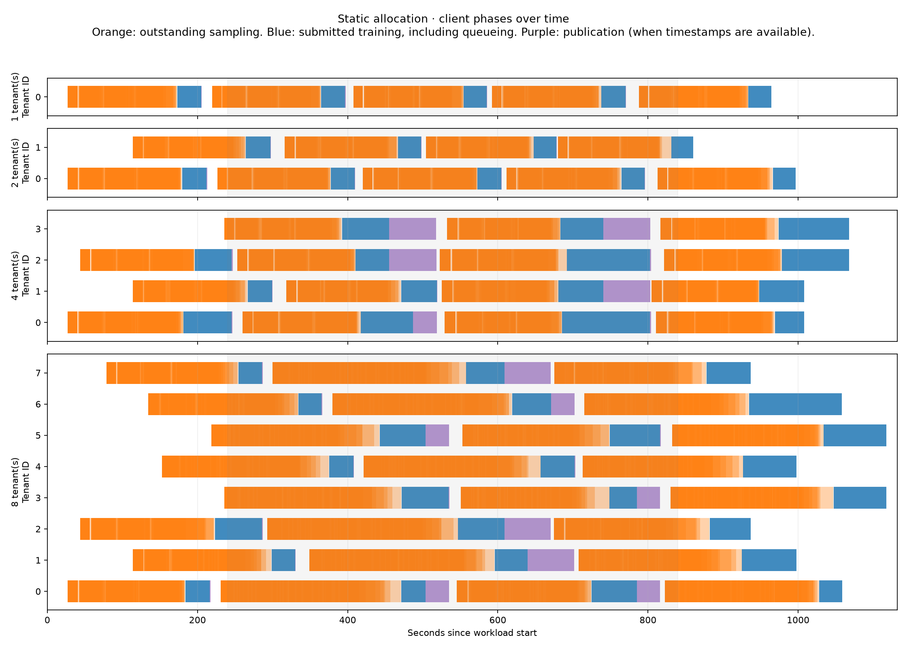

# GPU Borrowing (Experimental)

An agent training loop spends part of its time generating rollouts and part of
its time updating a LoRA adapter. While agents are generating, the training GPUs
may have little to do. GPU borrowing lets TuFT use that spare capacity for
rollouts, using the frozen base weights already held by the trainer.

There are two kinds of sampler in this setup. The **dedicated sampler** runs on
GPUs reserved for inference. It handles TuFT's OpenAI-compatible endpoints **and**
Tinker sampling requests, and can keep serving while training is running. The
**borrowed-GPU sampler** runs on the training GPUs and helps with eligible
Tinker sampling requests when those GPUs are available. It does not serve the
OpenAI-compatible endpoints.

Each tenant keeps its own LoRA adapter and optimizer state. Sampling uses a
published snapshot of an adapter, so an update cannot change a request that is
already running. Borrowing is experimental and disabled by default. Set
`sampling.borrowing.enabled: true` to let eligible sampling requests use idle
training GPUs. The sampler shares the trainer's frozen base weights, avoiding
another full base-model copy on those GPUs.

## Where does a sampling request go?

The API your client calls determines which samplers TuFT can use:

| Your client sends | TuFT sends the work to |
| --- | --- |
| An OpenAI-compatible chat or completion request at `/oai/api/v1/chat/completions` or `/oai/api/v1/completions` | A dedicated sampler, for both streaming and non-streaming requests. With multiple dedicated replicas, TuFT rotates requests among them independently of Tinker traffic. |
| A Tinker sampling request, such as `sampling_client.sample(...)` | The sampling scheduler, which chooses a dedicated sampler or, when eligible, the borrowed-GPU sampler. |

You keep using the same API throughout a request. TuFT does not forward a Tinker
request to the OpenAI-compatible endpoint when it chooses the dedicated sampler;
it calls that sampler's sampling backend. Likewise, turning on borrowing
does not make OpenAI-compatible traffic borrow the training GPUs.

## When does TuFT borrow a training GPU?

TuFT uses borrowing to serve overflow. A queued Tinker request can borrow only
when all dedicated samplers have filled their admission slots, the training GPUs
have no active or pending training or maintenance operation, and the borrowed-GPU
sampler has capacity. The request must also fit the configured token allowance.

These checks use current state, not predicted latency or expected training
arrivals. There is no calibration period. As borrowed requests finish, more
queued requests can borrow if the same conditions hold. Dedicated samplers are
preferred whenever they have room; round-robin routing chooses among eligible
samplers. A full admission pool does not necessarily mean the GPU itself is fully
utilized.

## When does TuFT drain for training?

**As soon as a training or maintenance operation is queued, TuFT stops admitting
new requests to the borrowed-GPU sampler.** This rule uses queued work directly. Already admitted
sampling requests finish normally; TuFT does not interrupt or partially resume
rollouts. Before training executes, the borrowed-GPU sampler sleeps and releases its
KV cache. Dedicated samplers keep serving throughout this transition.

For example, if four borrowed requests are running when a tenant submits a
backward pass, no fifth request can borrow the GPUs. Training waits for those four
to finish and for the phase switch. A slow generation can therefore delay training
for the duration of that request. New sampling work uses the dedicated
samplers or waits in the bounded Tinker queue. A full queue or an expired admission
deadline returns an error.

Publishing an adapter makes it available on the dedicated samplers first. The
borrowed-GPU sampler loads that snapshot when it first receives an admitted
request for it. A busy trainer therefore does not hold up publication to dedicated
samplers. Snapshot loading on the borrowed GPU remains protected from concurrent
training. If that load fails, the request retries on a dedicated sampler.

Ready optimizer steps and tenant-scoped checkpoints can move ahead of unrelated training work
so tenants can publish adapters and begin another rollout sooner. TuFT preserves
each run's operation order and permits at most two such overtakes before serving
the oldest waiting operation. This bounded priority is internal and applies when borrowing is enabled.

Borrowing can resume after pending exclusive work clears and the post-training
brief internal quiet period expires, provided the admission checks pass again.

## Enable borrowing

To try the feature, start with the configuration that matches your training backend
in `benchmarks/borrowing/`:

- {download}`HF: two H100 80GB GPUs <../../../../benchmarks/borrowing/tuft_config.shared-weight.h100.yaml>`.
- {download}`FSDP: four H100 80GB GPUs <../../../../benchmarks/borrowing/tuft_config.shared-weight.fsdp.h100.yaml>`.

For example, from the repository root:

```bash
tuft launch --config benchmarks/borrowing/tuft_config.shared-weight.h100.yaml
```

Adjust the model, context length and memory budget for your workload before
launching. These examples use different settings from the saved benchmark below.
If you already have a TuFT configuration, the commented borrowing block in
`config/tuft_config.example.yaml` shows the options to add.

| Setting | Requirement |
| --- | --- |
| `sampling.borrowing.enabled` | `true` (experimental, opt-in) |
| `colocate` | `true`, with both training and sampling capabilities |
| `sampling_kv_cache_memory_bytes` | Explicit KV cache budget per sampler GPU; leave space for training activations and adapters |
| `data_parallel_size` | At least 2; includes the sampler on the training GPUs |
| HF | `tensor_parallel_size: 1` |
| FSDP | `fsdp_num_gpus == tensor_parallel_size`, with the shared group on one node |

With two sampling replicas, HF uses two GPUs. FSDP with two ranks uses four:
two shared training/sampling GPUs and two dedicated sampling GPUs. Each base
model reserves its own group. Shared weights must be unquantized.

### Settings to tune first

Borrowing has three settings under each model's `sampling.borrowing` block:

| Setting | Default | Purpose |
| --- | --- | --- |
| `enabled` | `false` | Allow eligible overflow requests to use training GPUs. |
| `max_inflight` | `1` | Maximum borrowed requests at once. Start small: training must drain admitted work. |
| `max_request_tokens` | `256` | Maximum per-request token allowance across all samples. Increase explicitly for long-context agents. |

TuFT calculates the token allowance as:

```text
num_samples × (prompt tokens + requested output tokens per completion)
```

The output allowance is the requested limit, not the eventual generated length.
For example, a 3,000-token prompt with one completion of up to 256 tokens needs
3,256 tokens. Four completions need 13,024. Larger requests stay on dedicated
samplers. Neither the token limit nor the concurrency limit guarantees a maximum
training delay; admitted requests finish without preemption.

The borrowing controller also uses these settings under `sampling`:

| Setting | Default | Purpose |
| --- | --- | --- |
| `max_inflight_per_replica` | `32` | Dedicated admission capacity; borrowing starts only when those slots are full. |
| `max_queued_requests` | `1024` | Maximum number of requests waiting for admission. |
| `queue_timeout_s` | `120` | Admission waiting limit in seconds, not a generation timeout. |
| `scheduling_trace_capacity` | `0` | Optional bounded admission, completion, and rejection logs; maximum 4,096. |

These queue and trace settings apply only when borrowing is enabled. The
dedicated-only path retains its existing routing behavior. OpenAI-compatible
requests bypass the borrowing controller in both cases.

For example, in a model entry under `supported_models`:

```yaml
sampling:
  max_inflight_per_replica: 32
  max_queued_requests: 1024
  queue_timeout_s: 120
  scheduling_trace_capacity: 4096
  borrowing:
    enabled: true
    max_inflight: 1
    max_request_tokens: 8192
```

Set `sampling_kv_cache_memory_bytes` outside this block to reserve an explicit
KV-cache budget per sampler GPU while leaving room for training activations and
adapters. This memory setting is required for borrowing.

The other model/engine settings serve different purposes: `max_cpu_loras` sizes
the host adapter cache, `sampling_max_num_seqs` controls vLLM sequence capacity,
and `sampling_enable_metrics` enables engine diagnostics. The advanced
`sampling_language_model_only`, `sampling_moe_backend`, and
`sampling_gdn_prefill_backend` settings support model compatibility, including
newer Qwen text and MoE models; they are not borrowing-policy controls.

To investigate why queued requests are not borrowing, set
`sampling.scheduling_trace_capacity: 4096`. The trace shows admission decisions,
request durations, and how long training waits for borrowed requests to finish.

## What happens to the weights?

The trainer owns the frozen base weights. The borrowed-GPU sampler accesses
that same GPU storage through CUDA IPC, so it does not need another full base
copy on the training GPUs. When training needs the GPUs, TuFT waits for borrowed
requests to finish and puts the sampler to sleep to free its KV cache. It wakes
the sampler when borrowing resumes.

With HF, compatible weight tensors are packed once during startup. With FSDP,
the base stays sharded: each sampler tensor-parallel rank shares the corresponding
trainer shard. Full weights gathered during training are temporary. Small
normalization and router weights remain replicated, and vocabulary padding can
require an additional allocation. Startup checks the layout and rejects
unsupported configurations explicitly.

### Compatibility and recovery

The experimental integration supports BF16 Qwen3 and Qwen3.5-family dense/MoE text
layouts. It checks for the tested torch 2.11.0 / vLLM 0.24.0 pair because some of
the integration uses internal, version-sensitive interfaces. Test compatibility
again before upgrading those packages.

The trainer process must stay alive while the sampler uses its storage. If TuFT
observes an actor or phase-switch failure, it disables borrowing. You can still
sample already-published snapshots on a healthy dedicated sampler, but training
and new publications require a restart. FSDP can recover from input rejections
and known checkpoint I/O errors only after every rank has finished safely. An
uncertain collective failure or partially applied update disables the group.

Sharing weights does not guarantee identical log probabilities across the
training and inference engines. Numerical calibration is a separate task.
Predictive wave alignment is also outside this feature. The default configuration
does not add a delay to align training bursts.

## Example: independent multi-turn agents

A useful starting point is to measure your workload **with borrowing disabled**.
More tenants may already fill the trainer's idle periods. Borrowing helps only
when sampling demand overlaps spare training capacity and the requests can finish
within an acceptable training delay.

We measured 1, 2, 4, and 8 tenants using Qwen3.5-4B with the HF trainer on two
GPUs: one fixed trainer and one dedicated sampler. Each tenant ran eight concurrent
four-turn coding trajectories, received test feedback from CPU containers, trained
its LoRA adapter, published a snapshot, and repeated. The dedicated sampler could
admit 32 requests; inference used eager execution.

Clients started independently within the first 240 seconds. Between rounds they
waited a random 0–20 seconds, with an additional 0–3 seconds of tool delay between
turns. There was no cross-tenant barrier. The same tenants kept the same initial
adapters and timing draws across runs, although resource queues could make their
later phases converge.

The table covers seconds **240–840**, after the arrival ramp. GPU utilization is
the time-weighted NVML busy percentage, not SM occupancy or percent of peak FLOPS.
Latencies include queueing and follow calls submitted in that window through
completion. Training latency includes backward and optimizer calls; publication
is separate.

| Tenants | Trainer GPU | Dedicated sampler GPU | Sampling p95 (s) | Training p95 (s; calls) | Updates completed in window |
| --- | ---: | ---: | ---: | ---: | ---: |
| 1 | 14.9% | 17.5% | 55.1 | 32.3 (3) | 3 |
| 2 | 31.1% | 24.8% | 57.7 | 32.5 (7) | 6 |
| 4 | 45.3% | 24.0% | 58.1 | 114.4 (9) | 11 |
| 8 | 76.3% | 39.6% | 71.7 | 64.1 (15) | 16 |



The plots use matching scales across tenant counts. The shaded interval is the
measurement window; the rest shows arrivals and final draining. With one tenant,
rollouts and training alternate. With eight, the trainer receives a steadier
stream of work, while sampling queueing grows.



Each tenant has the same row thickness and all panels share the same time axis.
Orange spans show outstanding sampling, blue shows training including queueing,
and purple shows publication waits. These are client call intervals, not a trace
of individual GPU kernels. Initially independent clients can still bunch together
behind training or publication work.

At eight tenants, the trainer had no ready training work for 19.1% of the window,
compared with 83.8% for one tenant. That leaves less room for borrowing as tenant
count rises. Idle time alone is not enough: eligible sampling must also be waiting,
and serving it must be worth the switching and possible drain delay.

These are **static-allocation results, not a borrowing speedup comparison**. There
was one run per tenant count with one task family; training p95 has only 3–15 calls
and should not be treated as a stable tail estimate. The four-tenant training tail
is higher than the eight-tenant tail because their queues and phases differ.
Completed updates measure system throughput, not improved learning quality.

For your deployment, compare completed updates per allocated GPU-second alongside
sampling latency and training drain waits. More occupied GPU time is useful only
if it improves the work your clients complete without unacceptable delays.
The {download}`benchmark report <../../../../benchmarks/borrowing/static-independent-20261106-results.md>`
contains the measurement details and saved-data references.
