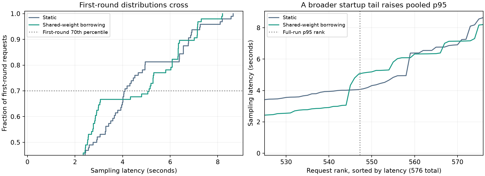

# Shared Weights (Experimental)

Agent RL alternates between generating rollouts and updating adapters. With many
tenants using the same base model, training GPUs can sit idle during generation.
This experimental mode lets those GPUs serve rollouts using the trainer's frozen
weights, without loading another full base model onto them.

Each tenant keeps its own LoRA adapter and optimizer state. Sampling uses a
published adapter snapshot; an update does not change an in-flight request.
A dedicated sampler remains available while the trainer is working.
The existing `round_robin` policy remains the default.

## Enable shared weights

Start with one of these configurations from `benchmarks/shared-weight/`:

- {download}`HF: two H100 80GB GPUs <../../../../benchmarks/shared-weight/tuft_config.shared-weight.h100.yaml>`.
- {download}`FSDP: four H100 80GB GPUs <../../../../benchmarks/shared-weight/tuft_config.shared-weight.fsdp.h100.yaml>`.

For example, from the repository root:

```bash
tuft launch --config benchmarks/shared-weight/tuft_config.shared-weight.h100.yaml
```

These are starting configurations, not the settings of the benchmark below.
Check the model, context length and memory budget before using them.
The main `config/tuft_config.example.yaml` also has a commented shared-weight block.

| Setting | Requirement |
| --- | --- |
| `scheduling.policy` | `shared_weight` (experimental, opt-in) |
| `colocate` | `true`, with both training and sampling capabilities |
| `sampling_kv_cache_memory_bytes` | Explicit KV cache budget per sampler GPU; leave space for training activations and adapters |
| `data_parallel_size` | At least 2; includes the sampler on the training GPUs |
| HF | `tensor_parallel_size: 1` |
| FSDP | `fsdp_num_gpus == tensor_parallel_size`, with the shared group on one node |

With two sampling replicas, HF uses two GPUs. FSDP with two ranks uses four:
two shared training/sampling GPUs and two dedicated sampling GPUs. Each base
model reserves its own group. Shared weights must be unquantized.

Set `flex_max_tokens` (default: 256) high enough for the prompt plus requested output of requests
you want to borrow capacity for. Longer requests stay on the dedicated sampler.
`flex_max_inflight` limits concurrent borrowed work. `max_queued_requests` and
`queue_timeout_s` bound admission waits. `cost_aware_borrowing` is enabled by
default; it borrows only when the estimated benefit covers switching costs and
fits before the next known training window. A cold model uses one bounded probe
at a time. `scheduling_trace_capacity` enables a bounded decision log.

## How it works

The trainer owns the frozen storage. The borrowing vLLM sampler maps it through
CUDA IPC. HF packs compatible tensors once at startup. FSDP keeps persistent base
shards and maps each to the matching vLLM tensor-parallel rank. Full weights gathered
during training are temporary; small normalization and router weights stay
replicated. Startup checks placement and layouts; unsupported layouts fail
explicitly. Vocabulary padding may require an additional allocation.

When training is queued, the scheduler stops admitting borrowed work, waits for
active requests to finish, and sleeps the borrowing sampler to release KV memory.
It wakes the sampler when borrowing resumes. Admission is bounded and fair across
tenants, with adapter grouping to reduce switching. Predictive wave alignment is
outside this feature. OpenAI-compatible requests stay on the dedicated sampler;
scheduled Tinker requests can use both.

This experimental integration supports BF16 Qwen3 and Qwen3.5-family dense/MoE
text layouts and checks the tested torch 2.11.0 / vLLM 0.24.0 pair. It uses internal,
version-sensitive interfaces, including CUDA IPC reducers and model/PEFT hooks.
An upgrade needs fresh compatibility checks.

The trainer process must outlive its shared views. An observed actor or phase
failure disables borrowing. Already-published snapshots remain usable on the
dedicated sampler; training and new publications require a restart. FSDP input
rejections and known checkpoint I/O errors are recoverable only when every rank
has finished safely. Uncertain collective or partial-update failures disable the
group. Training/inference numerical calibration is separate: this mode does not
promise identical log probabilities across engines.

## Saved benchmark

These measurements come from an earlier revision, before this PR was extracted.
They are one ordered comparison with one base model, not a new GPU measurement of
the current branch or a general speedup guarantee.

The workload used two H100 80GB GPUs, Qwen3-4B with the HF trainer, and eight tenants
with independent rank-8 adapters. Each tenant performed six updates. Each update
used four trajectories, each with two tool lookups followed by a shipping decision.
Tool results fed later prompts, and generated tokens fed real LoRA updates.
Prompts ranged from 1,781 to 3,604 tokens; outputs were short JSON actions.

Both arms used eager sampling, an 8,192-token context limit, a 4 GiB KV cache budget
per sampler GPU, and the same admission and batching settings. The static arm had
one trainer and one dedicated sampler. The shared-weight arm added a sampler on
the training GPU. Each completed 48 updates, 192 episodes and 576 requests, with
identical prompt/output token counts and 100% tool/decision success.
Initialization and warmup were excluded from timing; the first measured request
wave is included.

| Metric | Static | Shared-weight borrowing |
| --- | ---: | ---: |
| Wall time | 254.052 s | 236.319 s |
| Allocated GPU-seconds/update | 10.585 | 9.847 |
| Mean sampling latency | 2.032 s | 1.417 s |
| Sampling p95 | 4.072 s | 5.075 s |
| Mean NVML GPU utilization, GPU 0 | 68.05% | 75.76% |
| Mean NVML GPU utilization, GPU 1 | 4.90% | 5.12% |
| Mean NVML GPU utilization, both GPUs | 36.48% | 40.44% |

Both arms reserved two GPUs, so allocated GPU-seconds/update is twice the wall
time divided by 48 updates. It fell **6.98%**. Mean sampling latency fell **30.28%**,
while p95 rose **24.62%**. Storage checks found 8,044,936,192 unique shared base bytes,
zero copied base parameters and unchanged frozen-weight hashes.


GPU utilization is calculated separately from the saved NVML readings, polled
about every 0.2 seconds: 1,259 samples for static and 1,175 for shared weights.
The table uses arithmetic sample means; GPU numbers are NVML device indices.
The saved NVML trace does not record which engine was assigned to each device.
The two-GPU mean rose **3.97 percentage points**. [NVML reports](https://docs.nvidia.com/deploy/archive/R550/nvml-api/structnvmlUtilization__t.html)
the fraction of its sampling interval when a kernel was executing. It does not measure SM occupancy,
FLOP utilization or useful training work. The raw field is named `sm_percent`,
but it stores NVML GPU utilization. These device-wide samples do not identify
which engine was active or why utilization changed.


### Startup latency and limits

All 29 requests above the shared-weight arm's pooled p95 were first-turn requests
in the initial round. Later-round p95 was 1.937 s versus 2.813 s static. Warmup
sampling bypassed the scheduler, and the dedicated sampler's initial service was
slower in the shared-weight run. The borrowing sampler made nine serial cold
probes while waiting for the dedicated sampler to drain. Training and publication
drains did not cause these outliers. No predictive holds were applied.



The saved telemetry cannot explain why the dedicated sampler started more slowly.
Calibration under sustained load, correlated engine timing, and representative
warmup remain follow-up work. The full-run results above include startup.
Training service also improved, so the wall-time gain cannot all be attributed
to scheduling. This workload verifies system behavior, not learning convergence
or numerical equivalence between training and inference.

Code, example configurations, figures and raw telemetry are in
`benchmarks/shared-weight/`. You can download the
{download}`raw telemetry <../../../../benchmarks/shared-weight/agent-telemetry.json>`
and {download}`summary <../../../../benchmarks/shared-weight/agent-results.json>`.
To regenerate reports without GPU work, see that directory's README.
