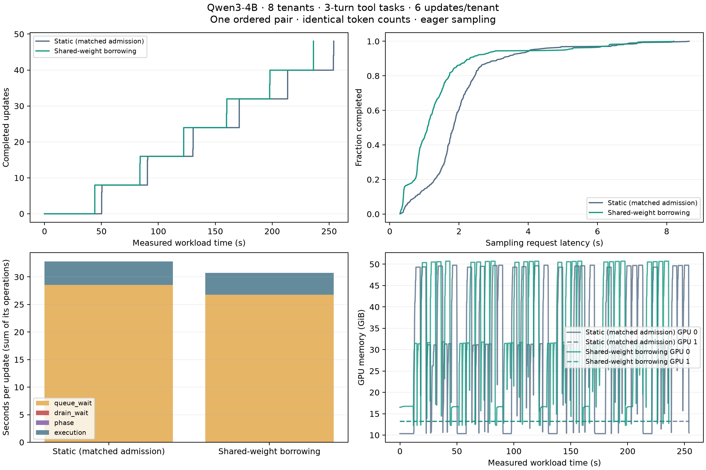
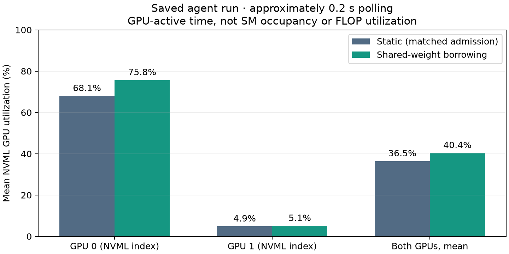

# Shared Weights (Experimental)

An agent training loop spends part of its time generating rollouts and part of
its time updating a LoRA adapter. While agents are generating, the training GPUs
may have little to do. Shared-weight mode lets TuFT use that spare capacity for
rollouts, using the frozen base weights already held by the trainer.

There are two kinds of sampler in this setup. The **dedicated sampler** runs on
GPUs reserved for inference. It handles TuFT's OpenAI-compatible endpoints **and**
Tinker sampling requests, and can keep serving while training is running. The
**shared-weight sampler** runs on the training GPUs and helps with eligible
Tinker sampling requests when those GPUs are available. It does not serve the
OpenAI-compatible endpoints.

Each tenant keeps its own LoRA adapter and optimizer state. Sampling uses a
published snapshot of an adapter, so an update cannot change a request that is
already running. This feature is experimental and opt-in; `round_robin` remains
the default policy.

## Where does a sampling request go?

The API your client calls determines which samplers TuFT can use:

| Your client sends | TuFT sends the work to |
| --- | --- |
| An OpenAI-compatible chat or completion request at `/oai/api/v1/chat/completions` or `/oai/api/v1/completions` | A dedicated sampler, for both streaming and non-streaming requests. With multiple dedicated replicas, TuFT rotates requests among them. |
| A Tinker sampling request, such as `sampling_client.sample(...)` | The sampling scheduler, which chooses a dedicated sampler or, when eligible, the shared-weight sampler. |

You keep using the same API throughout a request. TuFT does not forward a Tinker
request to the OpenAI-compatible endpoint when it chooses the dedicated sampler;
it calls that sampler's sampling backend. Likewise, turning on shared weights
does not make OpenAI-compatible traffic borrow the training GPUs.

For Tinker requests, an idle trainer alone is not enough to trigger borrowing.
The shared-weight sampler must have room, the request must fit its token limit,
and no training or other operation may be waiting to reserve those GPUs. After a
training operation, there is also a short pause before borrowing can resume.
With the default cost-aware policy, TuFT uses recent timings to decide whether
borrowing is likely to finish sooner than using a dedicated sampler, including
the time needed to switch phases. It also checks the next expected training
window when one is known. An eligible request can still go to a dedicated sampler.

Before those timing estimates are available, TuFT learns with one bounded request
at a time. These probes require a backlog and full dedicated-sampler admission
slots. If no sampler can accept a request yet, it waits in the bounded Tinker
queue; a full queue or an expired admission deadline produces an error.

For example, suppose several tenants request rollouts through the Tinker client
while the trainer is idle. TuFT can place some of those requests on the
shared-weight sampler if borrowing is worthwhile. As soon as a training operation is
queued, TuFT stops admitting new work there and waits for its active requests to
finish before training starts. Dedicated samplers continue serving requests,
including any OpenAI-compatible traffic, throughout that phase change.

## Enable shared weights

To try the feature, start with the configuration that matches your training backend
in `benchmarks/shared-weight/`:

- {download}`HF: two H100 80GB GPUs <../../../../benchmarks/shared-weight/tuft_config.shared-weight.h100.yaml>`.
- {download}`FSDP: four H100 80GB GPUs <../../../../benchmarks/shared-weight/tuft_config.shared-weight.fsdp.h100.yaml>`.

For example, from the repository root:

```bash
tuft launch --config benchmarks/shared-weight/tuft_config.shared-weight.h100.yaml
```

Adjust the model, context length and memory budget for your workload before
launching. These examples use different settings from the saved benchmark below.
If you already have a TuFT configuration, the commented shared-weight block in
`config/tuft_config.example.yaml` shows the options to add.

| Setting | Requirement |
| --- | --- |
| `scheduling.policy` | `shared_weight` (experimental, opt-in) |
| `colocate` | `true`, with both training and sampling capabilities |
| `sampling_kv_cache_memory_bytes` | Explicit KV cache budget per sampler GPU; leave space for training activations and adapters |
| `data_parallel_size` | At least 2; includes the sampler on the training GPUs |
| HF | `tensor_parallel_size: 1` |
| FSDP | `fsdp_num_gpus == tensor_parallel_size`, with the shared group on one node |

With two sampling replicas, HF uses two GPUs. FSDP with two ranks uses four:
two shared training/sampling GPUs and two dedicated sampling GPUs. Each base
model reserves its own group. Shared weights must be unquantized.

### Size the borrowing limit for your requests

`flex_max_tokens` defaults to 256, which is usually too small for agent rollouts
with long prompts. TuFT estimates a Tinker request's token budget as:

```text
num_samples × (prompt tokens + max_tokens per completion)
```

Here, `max_tokens` is the requested output limit, not the eventual output length.
Requests above `flex_max_tokens` use dedicated samplers. For example, with a limit
of 8,192, a 3,000-token prompt asking for one completion of up to 256 tokens fits
(3,256 tokens). Asking for four completions in the same call does not (13,024
tokens). This is an eligibility check, not a promise that a fitting request will
be sent to the shared-weight sampler.

`flex_max_inflight` limits how many requests can borrow at once. Keep
`cost_aware_borrowing` enabled to account for switching costs. You can set
`scheduling_trace_capacity` to keep a bounded log of scheduling decisions when
you want to understand why a request did or did not borrow capacity.
`max_queued_requests` and `queue_timeout_s` control the Tinker admission queue;
they do not govern the OpenAI-compatible proxy path.

## What happens to the weights?

The trainer owns the frozen base weights. The shared-weight vLLM sampler accesses
that same GPU storage through CUDA IPC, so it does not need another full base
copy on the training GPUs. When training needs the GPUs, TuFT waits for borrowed
requests to finish and puts the sampler to sleep to free its KV cache. It wakes
the sampler when borrowing resumes.

With HF, compatible weight tensors are packed once during startup. With FSDP,
the base stays sharded: each sampler tensor-parallel rank shares the corresponding
trainer shard. Full weights gathered during training are temporary. Small
normalization and router weights remain replicated, and vocabulary padding can
require an additional allocation. Startup checks the layout and rejects
unsupported configurations explicitly.

### Compatibility and recovery

The experimental integration supports BF16 Qwen3 and Qwen3.5-family dense/MoE text
layouts. It checks for the tested torch 2.11.0 / vLLM 0.24.0 pair because some of
the integration uses internal, version-sensitive interfaces. Test compatibility
again before upgrading those packages.

The trainer process must stay alive while the sampler uses its storage. If TuFT
observes an actor or phase-switch failure, it disables borrowing. You can still
sample already-published snapshots on a healthy dedicated sampler, but training
and new publications require a restart. FSDP can recover from input rejections
and known checkpoint I/O errors only after every rank has finished safely. An
uncertain collective failure or partially applied update disables the group.

Sharing weights does not guarantee identical log probabilities across the
training and inference engines. Numerical calibration is a separate task.
Predictive wave alignment is also outside this feature. The default configuration
does not add a delay to align training bursts.

## Saved benchmark

We checked the system with a small multi-tenant agent workload. In this saved
comparison, shared weights helped finish the workload sooner and reduced average
sampling latency.

The workload used two H100 80GB GPUs, Qwen3-4B with the HF trainer, and eight tenants
with independent rank-8 adapters. Each tenant performed six updates. For each update,
an agent tried four trajectories: it looked up policy and stock information, then
decided whether to ship an order. The tool results became part of the next prompt,
and the generated tokens fed real LoRA updates.
Prompts ranged from 1,781 to 3,604 tokens; outputs were short JSON actions.

Both arms used eager sampling, an 8,192-token context limit, a 4 GiB KV cache budget
per sampler GPU, and the same admission and batching settings. The static arm had
one trainer and one dedicated sampler. The shared-weight arm added a sampler on
the training GPU. Each completed 48 updates, 192 episodes and 576 requests, with
identical prompt/output token counts and 100% tool/decision success.
Initialization and warmup were excluded from timing; the first measured request
wave is included.

| Metric | Static | Shared-weight borrowing |
| --- | ---: | ---: |
| Wall time | 254.052 s | 236.319 s |
| Allocated GPU-seconds/update | 10.585 | 9.847 |
| Mean sampling latency | 2.032 s | 1.417 s |
| Sampling p95 | 4.072 s | 5.075 s |
| Mean NVML GPU utilization, GPU 0 | 68.05% | 75.76% |
| Mean NVML GPU utilization, GPU 1 | 4.90% | 5.12% |
| Mean NVML GPU utilization, both GPUs | 36.48% | 40.44% |

Both arms reserved two GPUs, so allocated GPU-seconds/update is twice the wall
time divided by 48 updates. It fell **6.98%**, and mean sampling latency fell
**30.28%**. Storage checks found 8,044,936,192 unique shared base bytes,
zero copied base parameters and unchanged frozen-weight hashes.



GPU utilization is calculated separately from the saved NVML readings, polled
about every 0.2 seconds: 1,259 samples for static and 1,175 for shared weights.
The table uses arithmetic sample means; GPU numbers are NVML device indices.
The saved NVML trace does not record which engine was assigned to each device.
The two-GPU mean rose **3.97 percentage points**. [NVML reports](https://docs.nvidia.com/deploy/archive/R550/nvml-api/structnvmlUtilization__t.html)
the fraction of its sampling interval when a kernel was executing. It does not measure SM occupancy,
FLOP utilization or useful training work. The raw field is named `sm_percent`,
but it stores NVML GPU utilization. These device-wide samples do not identify
which engine was active or why utilization changed.



### What this means for your deployment

Shared weights are useful when borrowing the training GPUs lets your tenants
complete more rollout-and-update work with the same GPU allocation. When deciding
whether to enable the feature, focus on completed updates per GPU-second and
whether the shared memory layout leaves enough room for your contexts and batches.
Keep sampling latency within the limits your agents need; faster overall training
does not guarantee that every request finishes sooner.

In this short comparison, full-run sampling p95 increased from 4.072 s to 5.075 s.
The slow requests were concentrated in the first measured rollout round. This is
a request-latency result, not a measure of server startup time, and it does not
establish the latency of a long-running deployment. The table includes that first
round so you can see the tradeoff alongside the throughput benefit.
